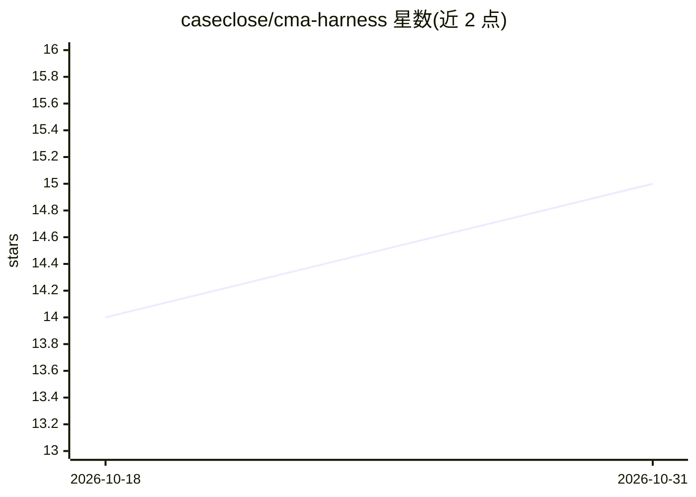

# caseclose/cma-harness

⭐ 15 · HTML · 推送 2026-09-02 · [GitHub](https://github.com/caseclose/cma-harness) · [官网](https://caseclose.github.io/cma-harness/) · 组织维护 · 中文 README

**面向长程多模态理解/生成/编辑的记忆中心 agent 及其基准**

研究项目：提出以记忆为中心的多模态 agent（CMA），将视觉历史外化为情景视觉记忆（EVM），由 CoRE 引擎做跨轮选择性检索，由多模态执行控制器（MEC）路由理解/生成/编辑/组合/纯对话等任务，并以统一场景引擎生成带检索标注的多轮对话支持 SFT/RL 训练。同一认知结构实例化为工具增强的多会话部署 harness。附带 M2CA-Bench 基准（100 会话×20 轮共 2,000 轮，4 个难度层）。README 阶段代码与数据集尚未发布，仅含论文/演示链接与结果表格。来自北京大学与腾讯微信视觉团队，部分架构已在微信小微 Agent 灰测。

## 筛选速览

| 维度 | 判定 | 备注 |
|---|---|---|
| AI 角色 | `ai-native` | 本体是模型或模型工具 |
| 许可风险 | `none` | — |
| 部署形态 | `None` |  |
| 模型依赖 | — | README 未给出锁定关系 |
| 硬件要求 | — | 无带数字的原话,不猜 |
| 安装摩擦 | `low` | 无编译、无系统依赖或容器化 |
| 成熟度 | — | 结构信号不足 |

## 能力要点

- 情景视觉记忆（EVM）外化视觉历史并做选择性跨轮检索
- MEC 控制器按轮次路由理解/生成/编辑/组合/对话任务
- M2CA-Bench：100 会话×20 轮（2,000 轮）、8 领域、4 难度层
- 统一场景引擎生成带检索标注的多轮对话，支持 SFT 与 RL

## 适用场景

- 长程多模态对话中做跨轮一致的图像生成与编辑
- 评估多模态 agent 的长程检索与 grounding 能力
- 参考其记忆外化与选择性检索机制构建自己的多模态 agent

## 场景标签

`模型评测` `图像生成` `多模态` `Agent 记忆` · 领域:Agent 开发

## 证据(README 行号)

> L45: We introduce a **memory-centric multimodal agent** that externalizes visual history into **Episodic Visual Memory (
> L102: - **Structured visual memory** — incoming and generated images are compressed into captions, tags, thumbnails, and
> L104: - **Executive task control** — the *Multimodal Executive Controller (MEC)* infers whether a turn requires understa

## 星数曲线

2026-10-18 14 → 2026-10-31 15（+1）

---
*卡片 v1 · prompt 1.4 · 生成 2026-10-31 · 置信度 mid · 依据 README sha `bd0cf6ccf764` · [字段定义](../../DATASET.md)*
