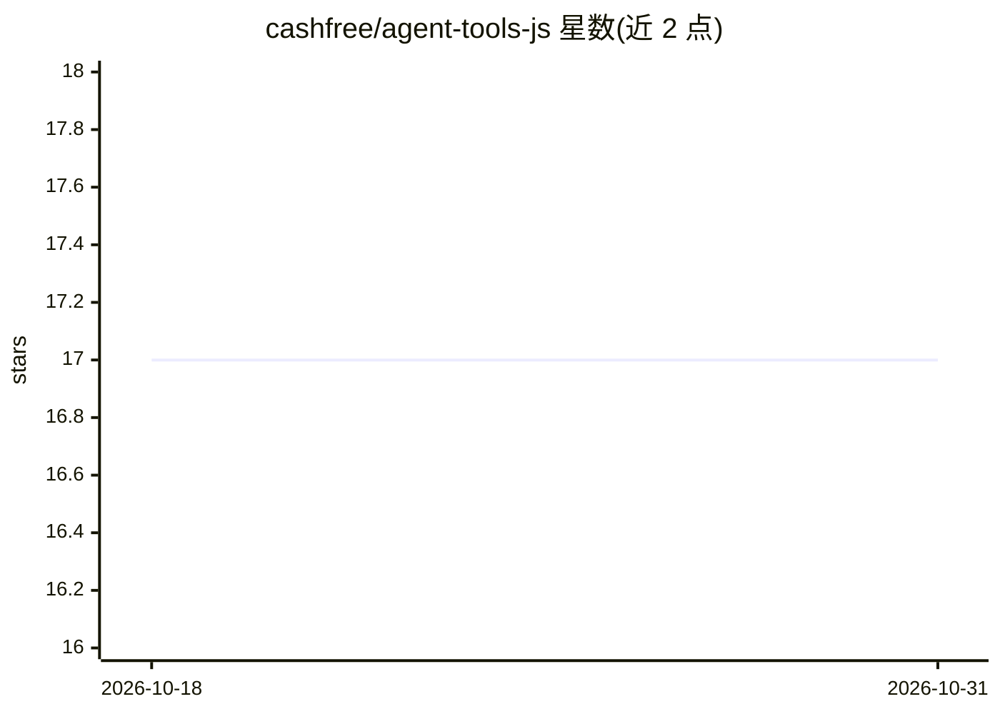

# cashfree/agent-tools-js

⭐ 17 · TypeScript · 推送 2026-07-09 · [GitHub](https://github.com/cashfree/agent-tools-js) · [官网](https://www.cashfree.com/docs/tools-ai/cashfree-agent-toolkit) · 组织维护

**让 agent 框架通过函数调用接入 Cashfree 支付与 KYC API 的 TS 工具包**

Cashfree 官方发布的 TypeScript 工具包，将支付网关订单/退款/支付操作与 SecureID 验证套件（PAN/GSTIN/银行卡/手机号/KYC/OCR/视频 KYC 等约 38 个工具）封装为函数调用工具，供 LangChain、Vercel AI SDK、OpenAI Agents SDK 三种框架按子路径引入。初始化需传入商户凭证与环境配置；支付网关与验证套件使用独立 API key，未单独传 SecureID 凭证时会复用 PG key 导致验证调用鉴权失败。需 Node 18+ 与 Cashfree 商户账户。

## 筛选速览

| 维度 | 判定 | 备注 |
|---|---|---|
| AI 角色 | `ai-ecosystem` | LLM/agent 周边工具 |
| 许可风险 | `none` | — |
| 部署形态 | `library` | 以包/库形式分发 |
| 模型依赖 | — | README 未给出锁定关系 |
| 硬件要求 | — | 无带数字的原话,不猜 |
| 安装摩擦 | `low` | 无编译、无系统依赖或容器化 |
| 成熟度 | — | 结构信号不足 |

## 能力要点

- 覆盖支付网关 21 个订单/退款/支付工具
- SecureID 验证套件含 KYC 链接、smartOcr、视频 KYC 等 17 个工具
- LangChain / Vercel AI SDK / OpenAI Agents SDK 三框架子路径接入
- 支持全量工具或按需选择单个工具注入 agent

## 适用场景

- 让对话式 agent 代用户创建订单、发起退款或查询支付状态
- 在 agent 流程中做身份验证（PAN/GSTIN/银行卡/手机 OTP）
- 通过 smartOcr 从证件图片/PDF 提取结构化数据

## 场景标签

`OCR` · 领域:感知与多模态

## 证据(README 行号)

> L3: The Cashfree Payments Agent Toolkit enables popular agent frameworks including LangChain, Vercel's AI SDK, and OpenA
> L50: The toolkit works with OpenAI Agents SDK, LangChain and Vercel's AI SDK and can be passed as a list of tools. For e

## 星数曲线

2026-10-18 17 → 2026-10-31 17（+0）

---
*卡片 v1 · prompt 1.4 · 生成 2026-10-29 · 置信度 high · 依据 README sha `63aedb4c1192` · [字段定义](../../DATASET.md)*
