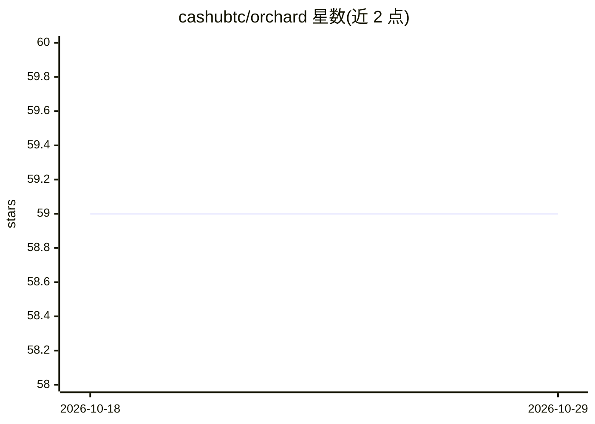

# cashubtc/orchard

⭐ 59 · TypeScript · MIT · 推送 2026-10-27 · [GitHub](https://github.com/cashubtc/orchard) · [官网](https://orchard.space) · 组织维护

**Cashu mint 管理的 Web 应用：运行自己的电子现金铸造服务**

Orchard 是用于 Cashu mint 管理的 Web 应用，自称『网络空间中的主权银行』，面向希望自行运营 Cashu 电子现金铸造服务的用户。项目以 MIT 许可开源，提供官网 orchard.space、文档站点 docs.orchard.space、CI 与 Release 徽章，可通过 Release 获取构建产物。README 未展示具体功能细节、安装步骤或系统依赖，完整信息需查阅其文档站点。

## 筛选速览

| 维度 | 判定 | 备注 |
|---|---|---|
| AI 角色 | `ai-enhanced` | 去掉 AI 部分产品仍成立 |
| 许可风险 | `permissive` | MIT |
| 部署形态 | `None` |  |
| 模型依赖 | — | README 未给出锁定关系 |
| 硬件要求 | — | 无带数字的原话,不猜 |
| 安装摩擦 | `low` | 无编译、无系统依赖或容器化 |
| 成熟度 | — | 结构信号不足 |

## 能力要点

- Cashu mint 管理的 Web 应用
- MIT 许可开源，提供 CI 与 Release 构建产物
- 提供独立文档站点 docs.orchard.space

## 适用场景

- 自建并运营 Cashu 电子现金 mint
- 管理基于 Lightning/Token 的电子现金发行业务

## 场景标签

 · 领域:比特币/电子现金基础设施

## 证据(README 行号)

> L1: Orchard
> L3:  Your sovereign bank in cyberspace

## 星数曲线

2026-10-18 59 → 2026-10-29 59（+0）

---
*卡片 v1 · prompt 1.4 · 生成 2026-10-24 · 置信度 low · 依据 README sha `7c7a0a569d61` · [字段定义](../../DATASET.md)*
