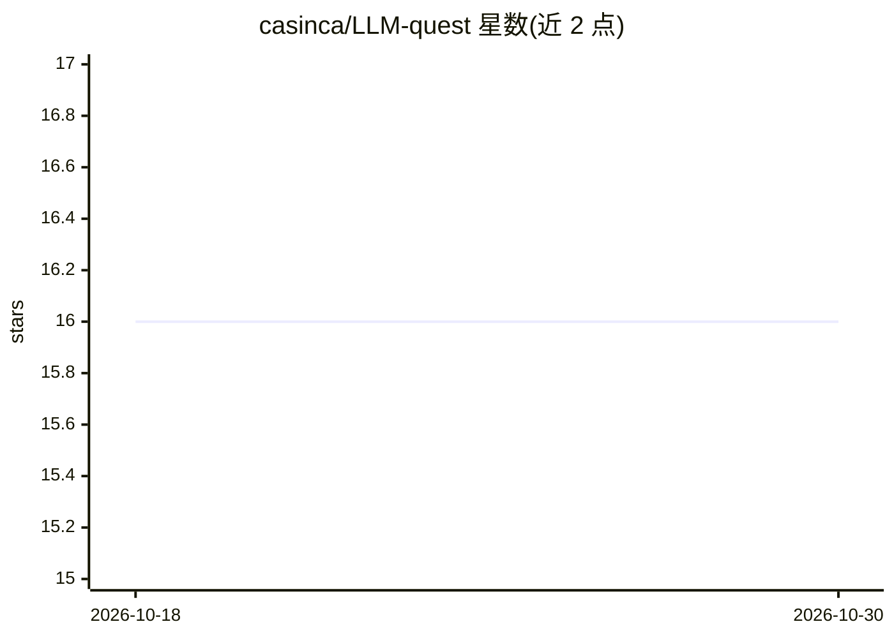

# casinca/LLM-quest

⭐ 16 · Python · Apache-2.0 · 推送 2026-04-11 · [GitHub](https://github.com/casinca/LLM-quest) · 个人维护

**从零复现 LLM 架构与研究论文的教学代码库**

以 PyTorch 从零实现（verbose、非精简）主流 LLM 架构与研究论文的实践仓库：架构覆盖 GPT-2 到 Llama 3.2、DeepSeek V3/R1、Gemma 3、Qwen3/Qwen3-Next/Qwen3.5 多模态、MiMo-V2-Flash；技术含 MoE 变体（Sparse/DeepSeek/LatentMoE）、DPO、RLHF-GRPO 变体、RLVR、RPT、SFT、LoRA 变体、Hyper-connections、QK-Clip、投机解码等。面向学习与实验的开发者与研究者，各子目录含 README，论文均引用链接；部分内容（GPT-2、DPO 等）注明与 rasbt 的 LLMs-from-scratch 相似。通过 uv 以可编辑模式安装本地包。

## 筛选速览

| 维度 | 判定 | 备注 |
|---|---|---|
| AI 角色 | `ai-knowledge` | 知识聚合/清单类 |
| 许可风险 | `permissive` | Apache-2.0 |
| 部署形态 | `library` | 以包/库形式分发 |
| 模型依赖 | — | README 未给出锁定关系 |
| 硬件要求 | — | 无带数字的原话,不猜 |
| 安装摩擦 | `low` | 无编译、无系统依赖或容器化 |
| 成熟度 | — | 结构信号不足 |

## 能力要点

- 覆盖 GPT-2→Llama→DeepSeek V3/R1→Qwen3.5 等多代架构的从零实现
- 对齐与推理方法：DPO、GRPO 变体（Dr.GRPO/DAPO/GSPO/SAPO）、RLVR、RPT
- 模型无关技术：Hyper-connections(mHC)、QK-Clip、投机解码、LoRA-XS 等
- 论文在各 README 或代码注释中引用并链接

## 适用场景

- 通过阅读/修改从零实现来学习 LLM 架构细节
- 复现近期研究论文（RAL、LatentMoE、Dynamic Tanh 等）的参考实现
- 在实现之上做实验与变体尝试

## 场景标签

`教程课程` · 领域:学习与行业

## 证据(README 行号)

> L5: **LLM Architectures, techniques, and research papers for practice, experimentation, and learning — from scratch.**
> L97: **\*** : Already covered by @rasbt; my code is similar.
> L111: Research papers used in the repo are always cited and linked in the relevant readmes or code comments.

## 星数曲线

2026-10-18 16 → 2026-10-30 16（+0）

---
*卡片 v1 · prompt 1.4 · 生成 2026-10-30 · 置信度 low · 依据 README sha `acc2fb8f4529` · [字段定义](../../DATASET.md)*
