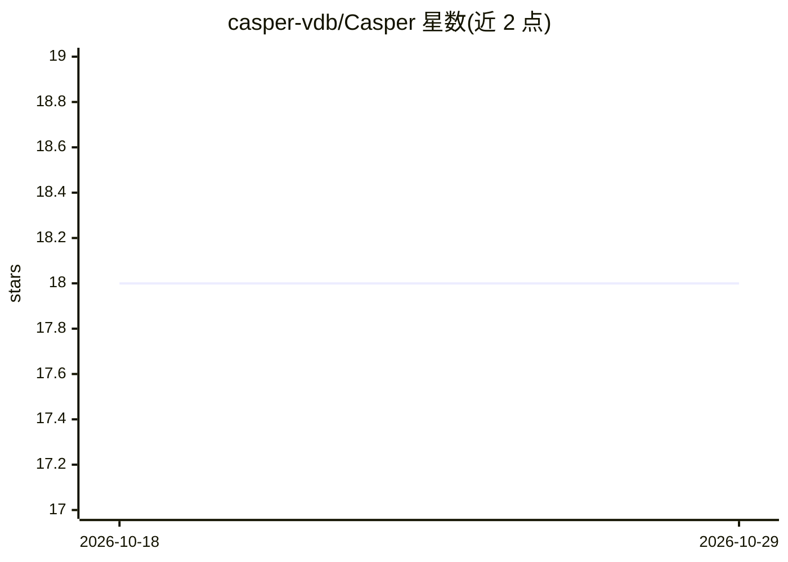

# casper-vdb/Casper

⭐ 18 · 推送 2026-07-21 · [GitHub](https://github.com/casper-vdb/Casper) · [官网](https://casper-frontend.pages.dev/) · 个人维护

**Rust 编写的向量搜索数据库，面向高负载检索与 RAG 应用**

以 Rust 实现的向量数据库，提供 HNSW 索引、四种距离度量（Euclidean/L2SQ/Cosine/Inner-Product）与 F32/I8 标量量化，支持单机与 master/replica 集群模式（基于 WAL 的 gRPC 复制，replica 可提升为 master）。对外暴露 HTTP 与 gRPC API，用于集合管理、向量增删改与相似度搜索；提供 Python/Go/Rust 客户端库。README 附带与 Qdrant 的自测基准（特定数据集与硬件配置），当前免费使用需通过 API token 运行。

## 筛选速览

| 维度 | 判定 | 备注 |
|---|---|---|
| AI 角色 | `ai-ecosystem` | LLM/agent 周边工具 |
| 许可风险 | `none` | — |
| 部署形态 | `self-host` | docker 或自建部署 |
| 模型依赖 | — | README 未给出锁定关系 |
| 硬件要求 | — | 无带数字的原话,不猜 |
| 安装摩擦 | `low` | 无编译、无系统依赖或容器化 |
| 成熟度 | — | 结构信号不足 |

## 能力要点

- HNSW 索引与 F32/I8 标量量化，四种距离度量
- master/replica 集群模式，WAL 复制，replica 可提升为 master
- HTTP & gRPC API，提供 Python/Go/Rust 客户端库
- 提供 Docker 镜像与 x86_64 Linux 预编译发布包

## 适用场景

- 为 RAG 应用存储和检索大规模向量
- 构建需要主从复制与读扩展的向量搜索服务
- 通过 i8 量化降低向量索引的内存占用

## 场景标签

`向量数据库` · 领域:知识与检索

## 证据(README 行号)

> L7: **Casper** is a high-performance Vector Search Database, perfectly suited for high-load search systems and AI applic

## 星数曲线

2026-10-18 18 → 2026-10-29 18（+0）

---
*卡片 v1 · prompt 1.4 · 生成 2026-10-29 · 置信度 high · 依据 README sha `50142c110553` · [字段定义](../../DATASET.md)*
