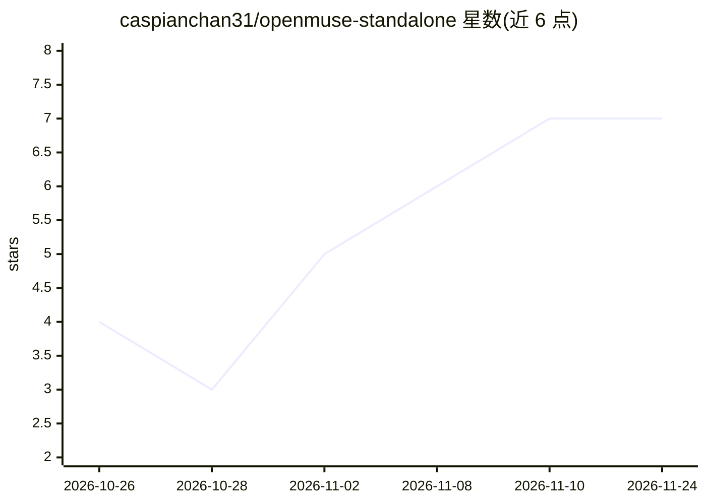

# caspianchan31/openmuse-standalone

⭐ 7 · TypeScript · MIT · 推送 2026-10-30 · [GitHub](https://github.com/caspianchan31/openmuse-standalone) · 个人维护 · 中文 README

**自托管个人 AI agent：对话数据存在自己的 Postgres，不依赖托管聊天云**

CopilotKit 上游 OpenMuse 的一个分支：把原本存在托管服务 CopilotKit Intelligence 的聊天层收回自托管——对话、线程列表存入自己的 Postgres 或内嵌 PGlite，回复由自己的服务器通过 SSE 流式输出，无需 Intelligence key 即可聊天。本地模式仅替换托管聊天层；模型调用、Gmail/日历、E2B 云桌面等仍按上游方式用用户自己的密钥运行。当前为 v0.1.0 alpha，单实例运行锁、无跨设备实时线程同步、本地模式不提供 Memories。

## 筛选速览

| 维度 | 判定 | 备注 |
|---|---|---|
| AI 角色 | `ai-native` | 本体是模型或模型工具 |
| 许可风险 | `permissive` | MIT |
| 部署形态 | `library` | 以包/库形式分发 |
| 模型依赖 | — | README 未给出锁定关系 |
| 硬件要求 | — | 无带数字的原话,不猜 |
| 安装摩擦 | `low` | 无编译、无系统依赖或容器化 |
| 成熟度 | `idea` | |

## 能力要点

- 对话与线程存储移入自有 Postgres 或内嵌 PGlite（默认，免安装）
- 回复由自托管服务器经 SSE 直接流式输出，不经托管网关
- 设置 CPK_INTELLIGENCE_API_KEY 后行为与上游完全一致
- 崩溃中断的回复可在 API 重启或锁过期后恢复

## 适用场景

- 自托管一个对话数据存在自己数据库里的个人 AI agent
- 在托管聊天服务不可用时仍能与 agent 对话
- 按 CHAT_RETENTION_DAYS 自定对话保留期限

## 场景标签

`AI 助手` · 领域:对话与助手

## 证据(README 行号)

> L3: **Self-hosted OpenMuse: a personal AI agent whose conversations live in your own Postgres, not a hosted chat cloud.*
> L19: **In one line:** a fork of CopilotKit's OpenMuse that stores every conversation in your own Postgres (embedded PGli
> L35: - Conversations, thread lists and the main chat are stored in your own Postgres (embedded PGlite by default).

## 星数曲线

2026-10-26 4 → 2026-11-24 7（+3）

---
*卡片 v1 · prompt 1.4 · 生成 2026-11-20 · 置信度 high · 依据 README sha `90ba545eef9c` · [字段定义](../../DATASET.md)*
