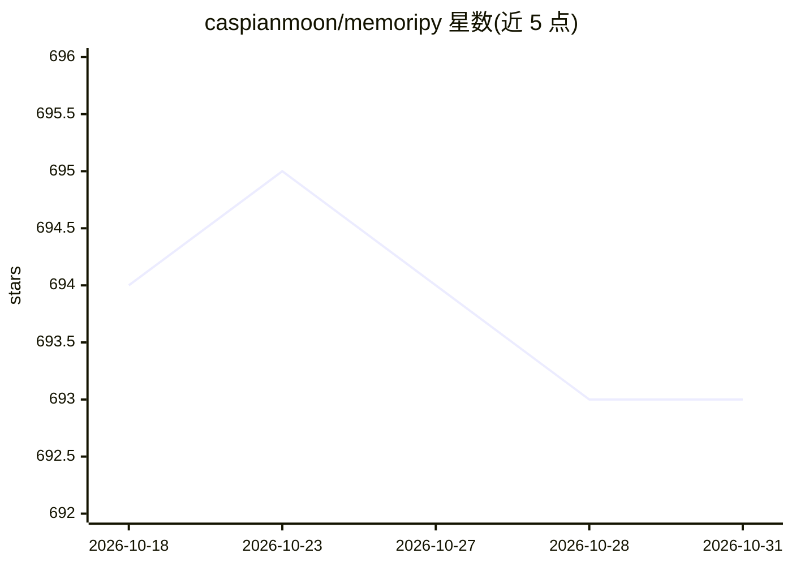

# caspianmoon/memoripy

⭐ 693 · Python · Apache-2.0 · 推送 2026-08-17 · [GitHub](https://github.com/caspianmoon/memoripy) · 个人维护

**面向 AI agent 的本地证据式记忆运行时**

为 AI agent 提供本地记忆运行时：写入经过准入策略过滤（拒绝检索回灌、隔离疑似秘密与外部指令），记录带双时态字段与不可变版本史；检索采用多通道（BM25/语义/实体/时间等）倒数排序融合，每条结果附带回执与引用。支持用户/agent/组织等多级作用域隔离，提供 CLI 审计、评测契约、HTTP 服务、官方 MCP 服务器与多租户网关。核心不要求 LLM 或嵌入提供商，内置 OpenAI 兼容 API、OpenRouter、Azure、Ollama 适配器。v4 在 v4 分支开发，PyPI 稳定版可能仍指向旧 API。

## 筛选速览

| 维度 | 判定 | 备注 |
|---|---|---|
| AI 角色 | `ai-ecosystem` | LLM/agent 周边工具 |
| 许可风险 | `permissive` | Apache-2.0 |
| 部署形态 | `library` | 以包/库形式分发 |
| 模型依赖 | local-ok | 支持本地模型 |
| 硬件要求 | — | 无带数字的原话,不猜 |
| 安装摩擦 | `low` | 无编译、无系统依赖或容器化 |
| 成熟度 | `idea` | |

## 能力要点

- 准入屏障拒绝噪声与检索回灌，写入前过滤
- 双时态记录与不可变版本史，支持当前/历史查询分离
- 多通道检索融合，每条结果附带回执与引用
- 提供 CLI 审计、契约评测、MCP 服务器与多租户网关

## 适用场景

- 为 agent 构建可审计、有出处的长期记忆层
- 通过 MCP 或 HTTP 服务接入现有 agent 框架
- 迁移前审计既有记忆库质量并对比其他记忆系统

## 场景标签

`Agent 记忆` · 领域:Agent 开发

## 证据(README 行号)

> L5: Memoripy is an evidence-first, local memory runtime for AI agents. It decides what deserves durable memory, preserve
> L14: - **Run locally** with no required third-party dependencies

## 星数曲线

2026-10-18 694 → 2026-10-31 693（-1）

---
*卡片 v1 · prompt 1.4 · 生成 2026-10-21 · 置信度 high · 依据 README sha `f4fdbf79be4f` · [字段定义](../../DATASET.md)*
