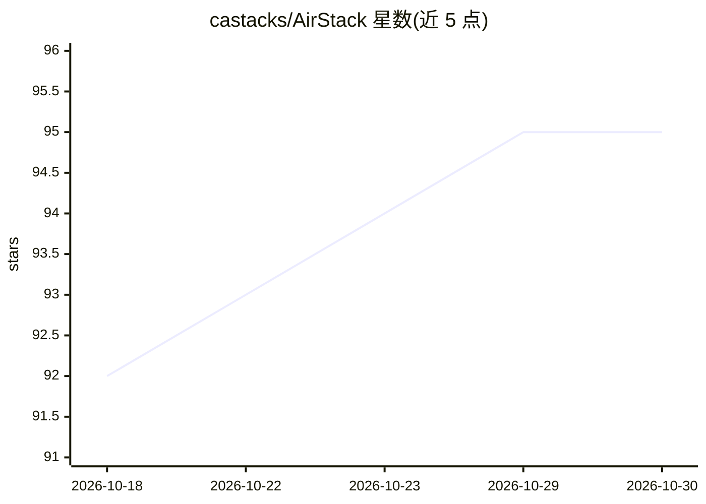

# castacks/AirStack

⭐ 95 · C++ · BSD-3-Clause-Clear · 推送 2026-10-29 · [GitHub](https://github.com/castacks/AirStack) · [官网](http://docs.theairlab.org/) · 组织维护

**面向无人机自主飞行的 ROS 2 开源栈，sim-to-real 一体部署**

卡内基梅隆大学 AirLab 开发的开源 ROS 2 无人机自主栈：用一条命令同时拉起仿真器（Isaac Sim / AirSim）、每机器人一个容器与 Foxglove 地面站；同一入口在仿真与实机（Jetson L4T）运行。采用分层自主架构，通过 stack/module/fleet 组合定义发射拓扑，CI 在 GPU 上跑整机飞行测试（起飞-悬停-降落、轨迹、航点）。仓库含 AGENTS.md 契约与 23 个技能供编码 agent 操作。要求 Docker+NVIDIA 容器工具链、RTX 3070 以上 GPU、Ubuntu 22.04/24.04。

## 筛选速览

| 维度 | 判定 | 备注 |
|---|---|---|
| AI 角色 | `ai-ecosystem` | LLM/agent 周边工具 |
| 许可风险 | `viral` | BSD-3-Clause-Clear |
| 部署形态 | `None` |  |
| 模型依赖 | — | README 未给出锁定关系 |
| 硬件要求 | — | 无带数字的原话,不猜 |
| 安装摩擦 | `low` | 无编译、无系统依赖或容器化 |
| 成熟度 | — | 结构信号不足 |

## 能力要点

- airstack up 一条命令拉起仿真器、机器人容器与地面站
- 仿真与实机（Jetson L4T）使用同一启动入口
- 分层自主架构，stack/module/fleet 可组合扩展
- CI 在 GPU 上运行整机飞行测试（含起飞-悬停-降落、航点导航）
- 23 个 agent 技能与 AGENTS.md 契约供编码 agent 操作仓库

## 适用场景

- 快速搭建无人机仿真到实机的自主飞行开发环境
- 多机器人编队在仿真场景中测试自主导航
- 开发者按模块扩展自主能力并纳入 CI 飞行验证

## 场景标签

 · 领域:机器人/无人机自主系统

## 证据(README 行号)

> L7: AirStack is an open ROS 2 stack for aerial robots — simulator, ground control,
> L9: AirLab at Carnegie Mellon University's Robotics Institute.

## 星数曲线

2026-10-18 92 → 2026-10-30 95（+3）

---
*卡片 v1 · prompt 1.4 · 生成 2026-10-23 · 置信度 high · 依据 README sha `197028abd093` · [字段定义](../../DATASET.md)*
