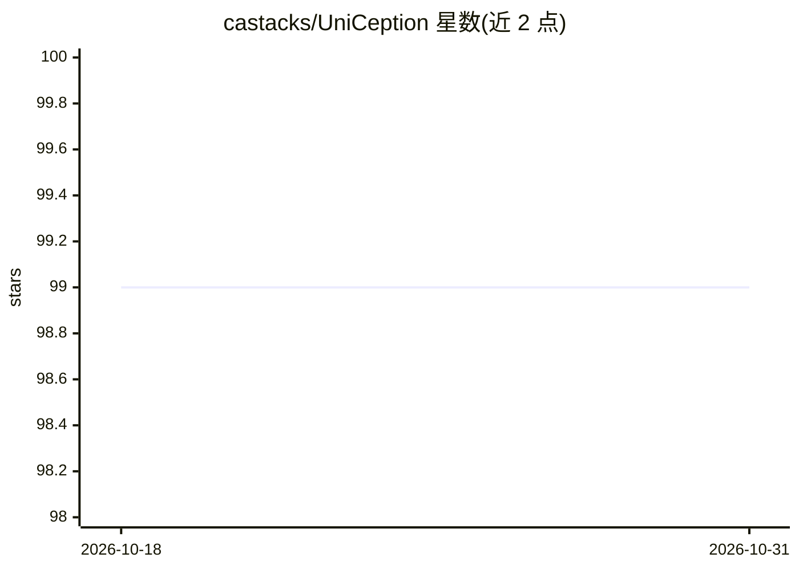

# castacks/UniCeption

⭐ 99 · Python · BSD-3-Clause · 推送 2026-03-22 · [GitHub](https://github.com/castacks/UniCeption) · [官网](https://pypi.org/project/uniception/) · 组织维护

**面向研究者的通用 3D/4D/场景理解感知模型构建模块库**

UniCeption 提供用于开发与训练可泛化感知模型的模块化构建块，覆盖 3D、4D、空间 AI 与场景理解，组件包括编码器、信息共享模块与预测头，通过 uniception.models 目录列出可用组件。面向希望灵活实验不同架构与配置的研究人员。安装支持 PyPI 与源码方式，提供安装验证、依赖检查、离线安装与检查点下载等命令行工具，含 CroCo RoPE 扩展可选安装。BSD 3-Clause 许可，由 AirLab 团队维护。

## 筛选速览

| 维度 | 判定 | 备注 |
|---|---|---|
| AI 角色 | `ai-ecosystem` | LLM/agent 周边工具 |
| 许可风险 | `permissive` | BSD-3-Clause |
| 部署形态 | `library` | 以包/库形式分发 |
| 模型依赖 | — | README 未给出锁定关系 |
| 硬件要求 | — | 无带数字的原话,不猜 |
| 安装摩擦 | `low` | 无编译、无系统依赖或容器化 |
| 成熟度 | — | 结构信号不足 |

## 能力要点

- 模块化组件：编码器、信息共享模块、预测头
- 提供安装验证、依赖检查、离线安装等命令行工具
- 支持下载 UniCeption 格式检查点
- CroCo 自定义 RoPE kernel 可选扩展

## 适用场景

- 组合编码器与预测头构建 3D/4D 感知模型
- 研究人员实验不同架构与配置
- 离线或无网络环境下部署训练环境

## 场景标签

`科研工具` `模型训练` · 领域:学习与行业

## 证据(README 行号)

> L3: UniCeption houses modular building blocks for developing and training generalizable perception models for all things
> L103: ## Currently Supported Components

## 星数曲线

2026-10-18 99 → 2026-10-31 99（+0）

---
*卡片 v1 · prompt 1.4 · 生成 2026-10-23 · 置信度 high · 依据 README sha `6ce72d5e79c2` · [字段定义](../../DATASET.md)*
