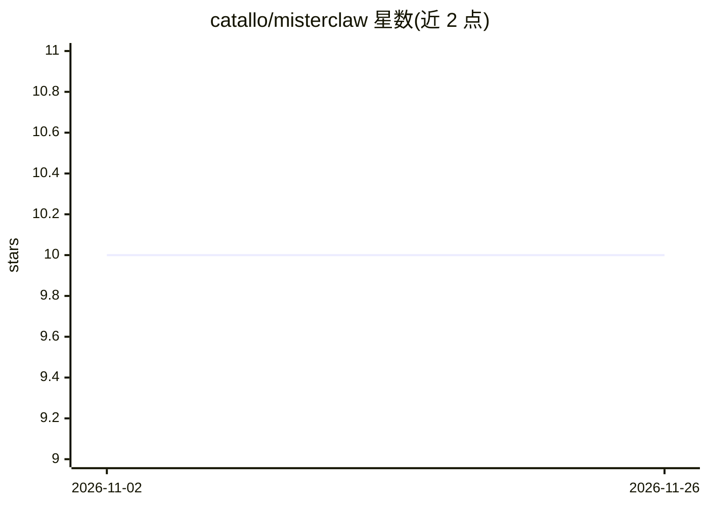

# catallo/misterclaw

⭐ 10 · Go · MIT · 推送 2026-10-11 · [GitHub](https://github.com/catallo/misterclaw) · 个人维护

**让 AI agent 通过 MCP 远程控制 MiSTer-FPGA 复古游戏机**

MiSTerClaw 是面向 MiSTer-FPGA 的 MCP 服务器，让 Claude、ChatGPT、Cursor 等兼容 MCP 的 AI agent 通过网络控制设备：启动游戏、搜索 ROM 库、截图、读写核心设置与 DIP 开关、导航 OSD 菜单、管理系统，并可配置 Tailscale VPN 实现远程访问。提供三个二进制：运行在 MiSTer（ARMv7）上的服务端、CLI 客户端和桥接 agent 的 MCP 服务器；无 MCP 支持的 agent 可用 CLI。通信采用 ClawExec 协议（TCP 9900，明文 JSON，无认证加密），需限制在局域网或 VPN 内使用。

## 筛选速览

| 维度 | 判定 | 备注 |
|---|---|---|
| AI 角色 | `ai-ecosystem` | LLM/agent 周边工具 |
| 许可风险 | `permissive` | MIT |
| 部署形态 | `desktop` | 安装包/桌面程序 |
| 模型依赖 | — | README 未给出锁定关系 |
| 硬件要求 | — | 无带数字的原话,不猜 |
| 安装摩擦 | `low` | 无编译、无系统依赖或容器化 |
| 成熟度 | — | 结构信号不足 |

## 能力要点

- 标准 MCP 协议接入，兼容任意 MCP 客户端，另附 CLI 客户端
- 17 个 MCP 工具覆盖启动游戏、截图、设置读写、OSD 导航、shell 命令
- 自动扫描 ROM 文件夹与核心实现系统检测，结果缓存到磁盘
- 支持 Tailscale VPN 远程访问与开机自启动安装

## 适用场景

- 让 AI agent 帮我搜索并启动 MiSTer 上的复古游戏
- 通过对话修改核心设置和 DIP 开关并导航 OSD 菜单
- 在家中局域网或通过 VPN 远程管理 MiSTer 设备

## 场景标签

`AI 助手` · 领域:对话与助手

## 证据(README 行号)

> L17: MiSTerClaw lets AI agents — Claude, ChatGPT, OpenClaw, Hermes, Cursor, and others — control a MiSTer-FPGA over the 
> L113: |`misterclaw-mcp`|Your machine|MCP server — bridges AI agents to MiSTer|

## 星数曲线

2026-11-02 10 → 2026-11-26 10（+0）

---
*卡片 v1 · prompt 1.4 · 生成 2026-11-19 · 置信度 high · 依据 README sha `4a2b417d742e` · [字段定义](../../DATASET.md)*
