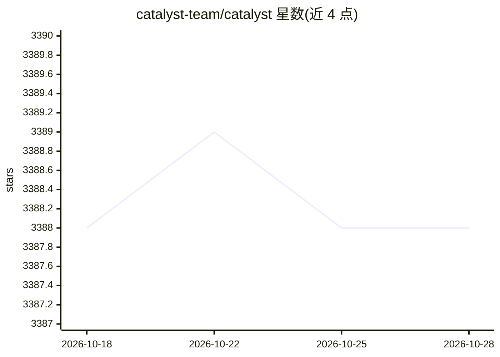

# catalyst-team/catalyst

⭐ 3,388 · Python · Apache-2.0 · 推送 2026-07-08 · [GitHub](https://github.com/catalyst-team/catalyst) · [官网](https://catalyst-team.com) · 组织维护

**面向研发者的 PyTorch 深度学习训练框架：少代码搭建训练流水线**

基于 PyTorch 的深度学习研发框架，提供训练循环、指标、early-stopping、模型 checkpoint 等 boilerplate 封装，支持 Notebook API、Config API（catalyst-run 命令）与自定义 Runner 三种使用方式，附 ML/CV/GAN/VAE/RecSys/超参优化（Optuna）等最小示例。兼容 Python 3.7+、PyTorch 1.4+，在 Ubuntu/macOS/Windows 及 WSL 上测试。PyTorch Ecosystem 成员，由 Catalyst.Team 团队维护，用户包括多所高校研究组与企业。

## 筛选速览

| 维度 | 判定 | 备注 |
|---|---|---|
| AI 角色 | `ai-ecosystem` | LLM/agent 周边工具 |
| 许可风险 | `permissive` | Apache-2.0 |
| 部署形态 | `library` | 以包/库形式分发 |
| 模型依赖 | — | README 未给出锁定关系 |
| 硬件要求 | — | 无带数字的原话,不猜 |
| 安装摩擦 | `low` | 无编译、无系统依赖或容器化 |
| 成熟度 | — | 结构信号不足 |

## 能力要点

- 提供带指标、early-stopping、checkpoint 的训练循环封装
- 支持 Notebook API、Config API 与 CustomRunner 三种接口
- 覆盖 ML/CV/GAN/VAE/RecSys/强化学习/超参优化的示例集
- 训练流程经收敛指标对比验证，声明可复现

## 适用场景

- 减少写训练循环的重复代码，快速跑通深度学习实验
- 用 Config API 以 YAML 配置驱动训练并复现实验
- 作为 Kaggle 竞赛或论文复现的基础框架

## 场景标签

`MLOps` · 领域:训练与推理

## 证据(README 行号)

> L29: Catalyst is a PyTorch framework for Deep Learning Research and Development.
> L31: so you can create something new rather than write yet another train loop.

## 星数曲线

2026-10-18 3,388 → 2026-10-28 3,388（+0）

---
*卡片 v1 · prompt 1.4 · 生成 2026-10-21 · 置信度 high · 依据 README sha `5d4ff669de3e` · [字段定义](../../DATASET.md)*
