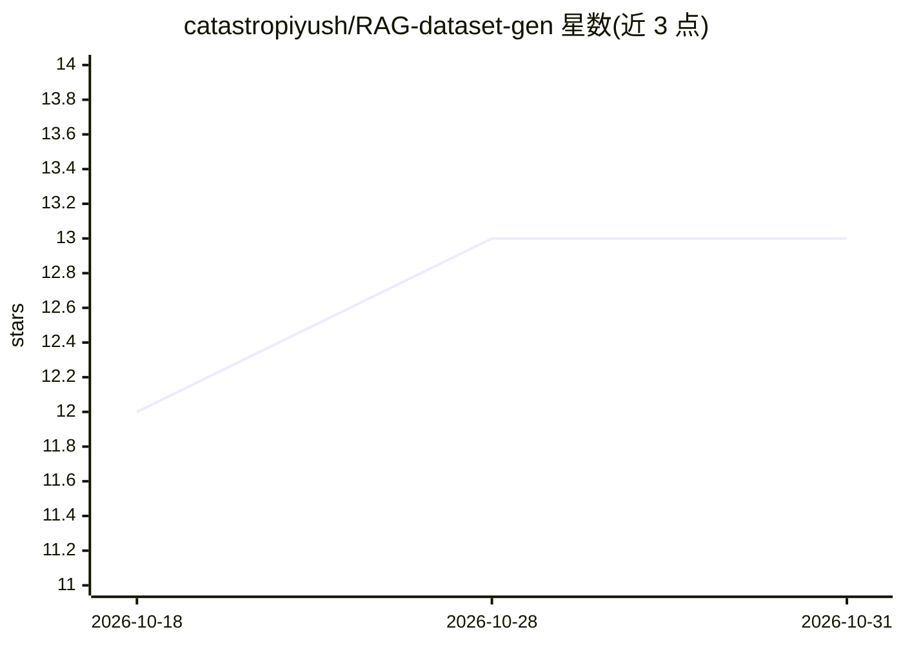

# catastropiyush/RAG-dataset-gen

⭐ 13 · Jupyter Notebook · 推送 2026-06-04 · [GitHub](https://github.com/catastropiyush/RAG-dataset-gen) · [官网](https://iopscience.iop.org/article/10.1088/2515-7639/ade1fa) · 个人维护

**用 RAG/LLM 从文献摘要提取储氢材料数据集的科研 notebook 集合**

包含 RAG_new.ipynb 与 Prompting.ipynb 两个 Jupyter notebook，在 Google Colab（T4 GPU）中运行：RAG 路径通过本地 Ollama 加载 llama3，对论文摘要按自然语言查询提取材料参数，无信息处标注 N/A；Prompting 路径用 unsloth/llama-3-8b-bnb-4bit 4bit 量化加载模型做同样抽取。产出包括金属氢化物测试集与 1,611 条氢储存性质数据（final_extracted_1611.xlsx），并附将提取合金用于 HYST 相关 ML 模型预测的验证结果。面向材料科学/储氢领域研究者。

## 筛选速览

| 维度 | 判定 | 备注 |
|---|---|---|
| AI 角色 | `ai-native` | 本体是模型或模型工具 |
| 许可风险 | `none` | — |
| 部署形态 | `library` | 以包/库形式分发 |
| 模型依赖 | local-ok | 支持本地模型 |
| 硬件要求 | — | 无带数字的原话,不猜 |
| 安装摩擦 | `low` | 无编译、无系统依赖或容器化 |
| 成熟度 | — | 结构信号不足 |

## 能力要点

- RAG 与直接 Prompting 两条 LLM 抽取路径（llama3 / llama-3-8b 4bit）
- 产出 1,611 条氢储存性质数据集与 250 条金属氢化物测试集
- notebook 设计为在 Google Colab T4 GPU 上运行
- 附带提取数据在 ML 模型上的预测验证文件

## 适用场景

- 我想从论文摘要批量提取储氢合金的材料参数
- 构建用于机器学习模型的材料科学数据集
- 复现论文中 RAG 与提示工程两种数据抽取流程

## 场景标签

`RAG` `科研工具` `文档解析` · 领域:知识与检索

## 证据(README 行号)

> L2: Contains the notebooks `Prompting.ipynb` `RAG_new.ipynb` used for creating datasets.\
> L7: A subset of the generated dataset using this framework showing hydrogen storage properties of various alloys and com
> L28: curl -fsSL https://ollama.com/install.sh | sh

## 星数曲线

2026-10-18 12 → 2026-10-31 13（+1）

---
*卡片 v1 · prompt 1.4 · 生成 2026-10-31 · 置信度 mid · 依据 README sha `061f116f815b` · [字段定义](../../DATASET.md)*
