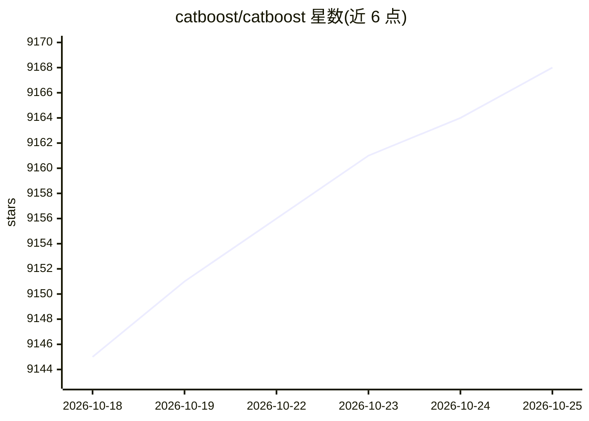

# catboost/catboost

⭐ 9,168 · C++ · Apache-2.0 · 推送 2026-10-24 · [GitHub](https://github.com/catboost/catboost) · [官网](https://catboost.ai) · 组织维护

**梯度提升决策树机器学习库，用于分类/回归/排序**

CatBoost 是基于决策树梯度提升的机器学习库，提供 Python、R、Java、C++ 接口及命令行版本，可从数值与类别特征训练模型并输出预测。支持 CPU 与 GPU/多 GPU 训练、通过 Apache Spark 与 CLI 的分布式训练，内置可视化工具、交叉验证、参数调优与特征重要度计算，并提供生产环境模型评估 API。README 中与同类 GBDT 库的质量与速度对比为项目自述声明。由 Yandex 以 Apache 2.0 许可维护，附两篇论文引用。

## 筛选速览

| 维度 | 判定 | 备注 |
|---|---|---|
| AI 角色 | `ai-native` | 本体是模型或模型工具 |
| 许可风险 | `permissive` | Apache-2.0 |
| 部署形态 | `library` | 以包/库形式分发 |
| 模型依赖 | — | README 未给出锁定关系 |
| 硬件要求 | — | 无带数字的原话,不猜 |
| 安装摩擦 | `low` | 无编译、无系统依赖或容器化 |
| 成熟度 | — | 结构信号不足 |

## 能力要点

- Python/R/Java/C++/CLI 多语言接口，数值与类别特征均支持
- GPU 与多 GPU 训练，及基于 Apache Spark 的分布式训练
- 内置可视化、交叉验证、特征重要度与多种预测模式
- 提供生产环境模型评估 API 与 Apache Spark 包

## 适用场景

- 训练分类、回归与排序模型并部署预测
- 处理含类别特征的表格数据的机器学习任务
- 在 GPU 或 Spark 集群上做分布式训练

## 场景标签

 · 领域:机器学习库

## 证据(README 行号)

> L14: CatBoost is a machine learning method based on gradient boosting over decision trees.
> L20:  - Fast GPU and multi-GPU support for out-of-the box training.

## 星数曲线

2026-10-18 9,145 → 2026-10-25 9,168（+23）

---
*卡片 v1 · prompt 1.4 · 生成 2026-10-20 · 置信度 high · 依据 README sha `b19a23f8d0dc` · [字段定义](../../DATASET.md)*
