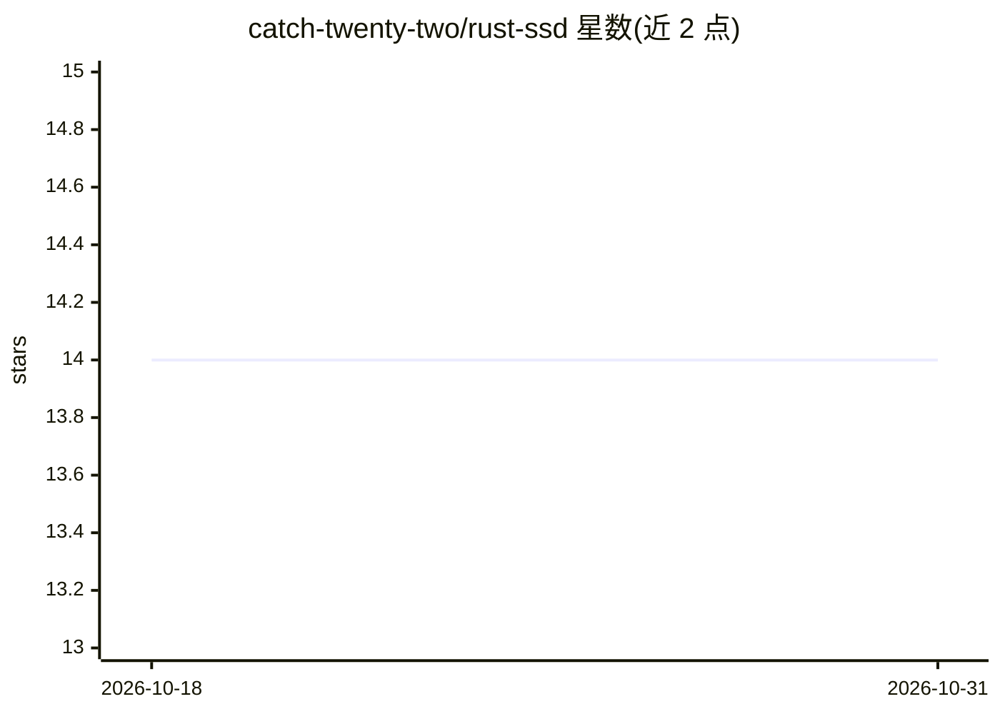

# catch-twenty-two/rust-ssd

⭐ 14 · Rust · NOASSERTION · 推送 2025-12-02 · [GitHub](https://github.com/catch-twenty-two/rust-ssd) · 个人维护

**Rust 实现的 SSD 目标检测：训练与推理，供 CV 学习与实战**

基于 Burn 深度学习框架用 Rust 从零实现 SSD（Single Shot MultiBox Detector）的目标检测应用，代码尽量贴近原论文并刻意过度文档化，作者定位其为学习工具与参考实现。提供 VGG（ONNX 导入）预训练骨干与可检测 person/cat/dog 的 SSD 300 模型下载；支持自定义类别训练（需 COCO 格式数据集）、JSON 配置超参、多种纯 tensor 图像增强。构建需设置 LIBTORCH_USE_PYTORCH=1 使 Burn 使用 libtorch 后端，训练需本地 COCO 数据集与足够硬件。许可证为 GPLv3（含 Burn 特别条款）。

## 筛选速览

| 维度 | 判定 | 备注 |
|---|---|---|
| AI 角色 | `ai-native` | 本体是模型或模型工具 |
| 许可风险 | `none` | NOASSERTION |
| 部署形态 | `None` |  |
| 模型依赖 | — | README 未给出锁定关系 |
| 硬件要求 | — | 无带数字的原话,不猜 |
| 安装摩擦 | `medium` | 含编译或系统依赖之一 |
| 成熟度 | — | 结构信号不足 |

## 能力要点

- 100% 纯 Rust 实现 SSD 目标检测，代码贴近原论文并过度文档化
- 提供预训练 VGG 骨干与 SSD 300（person/cat/dog）模型权重下载
- 支持自定义类别训练，超参与随机种子经 JSON 配置
- 纯 tensor 实现的十余种图像增强及边界框/标签同步变换

## 适用场景

- 学习 SSD 算法原理的文档化参考实现
- 在自定义类别数据上训练目标检测模型
- 用预训练模型对图像做推理并输出标注框 jpg

## 场景标签

`目标检测` `模型训练` `教程课程` · 领域:学习与行业

## 证据(README 行号)

> L15: Rust SSD is an object detection application built using Rust and the Burn framework. It implements the **Single Sho
> L27: https://arxiv.org/abs/1512.02325

## 星数曲线

2026-10-18 14 → 2026-10-31 14（+0）

---
*卡片 v1 · prompt 1.4 · 生成 2026-10-31 · 置信度 high · 依据 README sha `67156bc97f71` · [字段定义](../../DATASET.md)*
