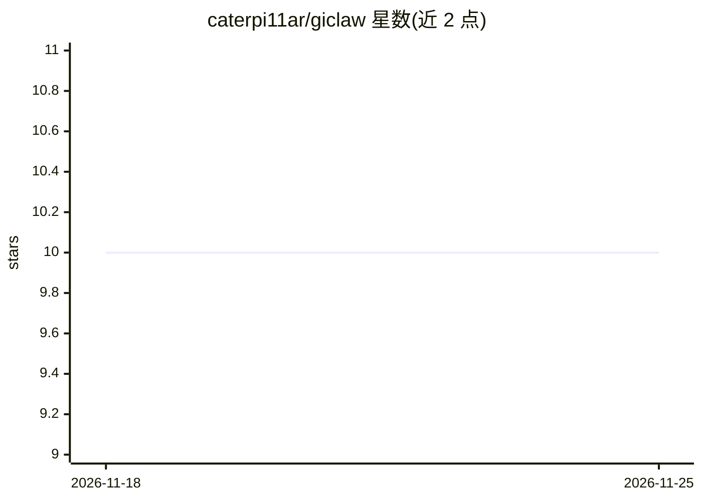

# caterpi11ar/giclaw

⭐ 10 · TypeScript · 推送 2026-10-19 · [GitHub](https://github.com/caterpi11ar/giclaw) · [官网](https://giclaw.cn) · 个人维护 · 中文 README

**视觉 AI 代理自动完成云原神每日奖励领取**

面向《原神》云游戏版本的自动化工具：通过视觉模型理解游戏截图，结合固定的键鼠回放步骤，自动领取月卡、邮件、纪行、成就与活动奖励。任务以 Markdown 格式的 SKILL.md 定义，内置 5 个已验收技能与 daily/rewards/full 流程；提供 giclaw evolve 从失败证据生成技能补丁并自动回滚，支持飞书/邮件/Webhook 通知与入站触发、cron 定时 Daemon 模式。需 Node >= 20.9，npm 全局安装，无需本地游戏客户端。红线策略禁止购买与消耗付费货币。

## 筛选速览

| 维度 | 判定 | 备注 |
|---|---|---|
| AI 角色 | `ai-native` | 本体是模型或模型工具 |
| 许可风险 | `none` | — |
| 部署形态 | `library` | 以包/库形式分发 |
| 模型依赖 | — | README 未给出锁定关系 |
| 硬件要求 | — | 无带数字的原话,不猜 |
| 安装摩擦 | `low` | 无编译、无系统依赖或容器化 |
| 成熟度 | — | 结构信号不足 |

## 能力要点

- 视觉模型定位 + 22 种确定性键鼠原子操作的混合执行
- Markdown 文件即可定义新技能，无需编写 TypeScript
- giclaw evolve 自动生成 SKILL.md 最小补丁，校验失败自动回滚
- 内置飞书/SMTP/IMAP/Webhook 连接器与 Daemon 定时调度

## 适用场景

- 每日自动领取云原神的月卡和邮件附件
- 定时跑成就、纪行、活动奖励收集流程
- 通过飞书或邮件触发和接收任务运行通知

## 场景标签

`浏览器自动化` · 领域:效率与自动化

## 证据(README 行号)

> L9: 通过视觉模型理解游戏截图，并结合可审计的确定性键鼠步骤，自动完成云原神中的月卡、邮件、纪行、成就和活动奖励领取。
> L13: - **视觉 + 确定性操作** — 视觉 AI 处理变化界面，固定键鼠步骤处理稳定入口

## 星数曲线

2026-11-18 10 → 2026-11-25 10（+0）

---
*卡片 v1 · prompt 1.4 · 生成 2026-11-19 · 置信度 high · 依据 README sha `ca79aeeb5eb0` · [字段定义](../../DATASET.md)*
