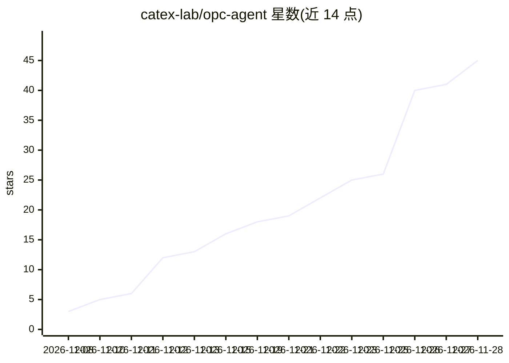

# catex-lab/opc-agent

⭐ 45 · TypeScript · MIT · 推送 2026-11-27 · [GitHub](https://github.com/catex-lab/opc-agent) · 组织维护 · 中文 README

**把本机多个 Agent CLI 收进一个 IM 界面的桌面应用**

基于 Electron + TypeScript 的本机多 Agent 团队协作桌面应用：将本机安装的 Agent CLI（Claude Code、Codex、Gemini 等 16 条接入定义）当作 IM 通讯录里的联系人，支持单聊、拉群、按人分派任务；提供统一事件协议、执行轨迹、跨 Agent 会话知识库、权限审批中心、四层记忆与工作区面板。应用本身不含模型，需本机至少装一个 Agent CLI 且需 Node.js 22+（依赖 node:sqlite）。只提供源码，不发布预编译安装包，运行数据与凭据全部落本地、无遥测。

## 筛选速览

| 维度 | 判定 | 备注 |
|---|---|---|
| AI 角色 | `ai-ecosystem` | LLM/agent 周边工具 |
| 许可风险 | `permissive` | MIT |
| 部署形态 | `library` | 以包/库形式分发 |
| 模型依赖 | — | README 未给出锁定关系 |
| 硬件要求 | — | 无带数字的原话,不猜 |
| 安装摩擦 | `medium` | 含编译或系统依赖之一 |
| 成熟度 | — | 结构信号不足 |

## 能力要点

- 16 条 Agent 接入定义：CLI 探测 13 条 + 厂商 SDK 直连 3 条（WorkBuddy/Claude Code/Codex）
- 单聊与群聊分派任务，Agent 执行过程折叠为结论式摘要，工具调用与行级 diff 可查
- 权限审批中心：23 类危险命令直接拒绝、14 条需人工确认
- 数据全部落本地 data/ 目录，不埋点、无崩溃上报、密钥不进源码

## 适用场景

- 我在本机装了多个 Agent CLI，想在统一 IM 界面里单聊或拉群分派任务
- 我想让多个 Agent 在同一个任务里接力或分工，不用手动复制粘贴
- 我想按会话/工作区/项目/全局范围检索跨 Agent 的历史对话

## 场景标签

`多智能体` · 领域:Agent 开发

## 证据(README 行号)

> L7: 本机多 Agent 团队协作桌面应用 —— 把本机安装的各类 Agent 当作通讯录里的联系人，可以单聊，也可以拉群分派任务。
> L69: 2. **本机至少装一个 Agent CLI**。这个应用本身不含任何模型，它只是把你自己装好的 Agent 收进一个界面。一个 CLI 都没装的话，打开会是空通讯录。
> L96: |Agent 接入|厂商 SDK（`@tencent-ai/agent-sdk` / `@anthropic-ai/claude-agent-sdk` / `@openai/codex-sdk`）与各 Agent 自有 CLI 两

## 星数曲线

2026-11-08 3 → 2026-11-28 45（+42）

---
*卡片 v1 · prompt 1.4 · 生成 2026-11-18 · 置信度 mid · 依据 README sha `bb7e67953822` · [字段定义](../../DATASET.md)*
