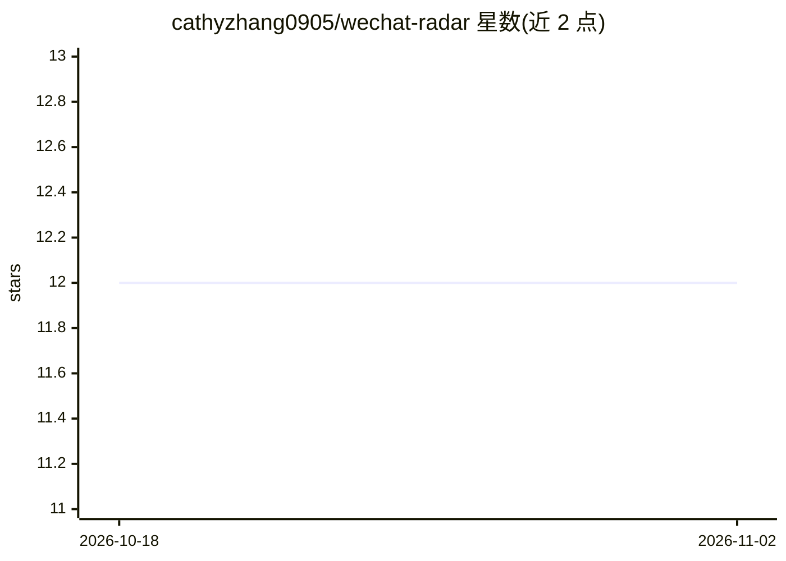

# cathyzhang0905/wechat-radar

⭐ 12 · Python · 推送 2026-09-07 · [GitHub](https://github.com/cathyzhang0905/wechat-radar) · 个人维护 · 中文 README

**AI 驱动的微信公众号智能日报工具：自动抓取筛选推送**

用 Python 编写的公众号文章筛选与推送工具：自动抓取监控公众号 24 小时内新文章，经规则预过滤广告、跨源去重后，由 LLM 按可配置的多维度（相关度/深度/信息密度/可行动性等）评分排序，生成日报推送到飞书/钉钉/企业微信/邮件/Telegram 等 8 个渠道。支持 Anthropic/OpenAI/DeepSeek/Ollama 等 12+ 模型服务，内置 48 个默认公众号。需注册微信公众号扫码登录，token 约每 3 天需重新扫码；另提供基于 Cubox 收藏记录的推荐命中率复盘脚本。

## 筛选速览

| 维度 | 判定 | 备注 |
|---|---|---|
| AI 角色 | `ai-native` | 本体是模型或模型工具 |
| 许可风险 | `none` | — |
| 部署形态 | `None` |  |
| 模型依赖 | local-ok | 支持本地模型 |
| 硬件要求 | — | 无带数字的原话,不猜 |
| 安装摩擦 | `low` | 无编译、无系统依赖或容器化 |
| 成熟度 | — | 结构信号不足 |

## 能力要点

- 规则预过滤 + 跨源去重 + LLM 多维度评分的流水线
- 8 种推送渠道，邮件支持 Gmail/QQ/163/Outlook 自动识别
- 12+ AI 模型可选，含本地 Ollama 与任意 OpenAI 兼容接口
- 对照 Cubox 收藏划线的反馈闭环复盘脚本

## 适用场景

- 每天从关注的公众号中筛选值得读的文章并推送到常用渠道
- 按个人兴趣背景定制文章评分与排序
- 复盘推荐命中率并调优评分 prompt 与权重

## 场景标签

`网页抓取` `推荐系统` · 领域:效率与自动化

## 证据(README 行号)

> L3: AI 驱动的微信公众号智能日报 — 自动抓取、多维度评分、个性化推荐、定时推送。
> L10: - **智能过滤** — 规则预过滤广告 + 跨源去重 + AI 多维度评分
> L145: 公众号列表 → 规则预过滤 → 跨源去重 → AI 多维度评分

## 星数曲线

2026-10-18 12 → 2026-11-02 12（+0）

---
*卡片 v1 · prompt 1.4 · 生成 2026-11-01 · 置信度 high · 依据 README sha `6c6f36ca2fe1` · [字段定义](../../DATASET.md)*
