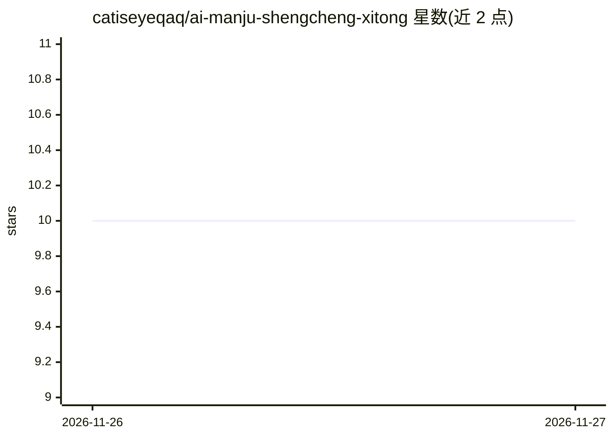

# catiseyeqaq/ai-manju-shengcheng-xitong

⭐ 10 · Python · NOASSERTION · 推送 2026-09-14 · [GitHub](https://github.com/catiseyeqaq/ai-manju-shengcheng-xitong) · 个人维护 · 中文 README

**写实 AI 电影/短剧本地生成流水线部署工程**

基于 ComfyUI 工作流框架的 AI 影视内容本地部署工程，集成 MiniMax-H3 音视频联合生成模型与 Qwen3.6 提示词润色服务（SGLang，OpenAI 兼容接口）。提供 9 套模板工作流覆盖文生视频、首尾帧图生视频、参考生视频与人物出图，含中文草稿到英文影视提示词的润色节点、PuLID 脸锁与音画对齐拼接链路。仓库只含部署配置、工作流模板与运维脚本，不含模型权重与完整成片；依赖 8×PPU-ZW810E 加速卡集群（约 768GB 显存）与 Ubuntu 24.04。

## 筛选速览

| 维度 | 判定 | 备注 |
|---|---|---|
| AI 角色 | `ai-native` | 本体是模型或模型工具 |
| 许可风险 | `none` | NOASSERTION |
| 部署形态 | `None` |  |
| 模型依赖 | — | README 未给出锁定关系 |
| 硬件要求 | — | 无带数字的原话,不猜 |
| 安装摩擦 | `low` | 无编译、无系统依赖或容器化 |
| 成熟度 | — | 结构信号不足 |

## 能力要点

- 9 套可直接导入的 ComfyUI 模板工作流（T2V/I2V/R2V/出图/全链路）
- MiniMax-H3 BF16 权重本地加载（约 129G），音画同出
- Qwen3.6-35B-A3B 提示词润色自定义节点，接入 MiniMax 官方 H3 提示词写作技能
- ComfyUI 与 SGLang 一键启停脚本与模型路径注册脚本

## 适用场景

- AI 短剧/漫剧分镜与镜头预演
- 产品广告、角色 PV、概念片快速出片
- 内容工作室批量化素材生产
- 对接业务 API 与队列调用的二次开发

## 场景标签

`视频生成` `图像生成` · 领域:内容生成

## 证据(README 行号)

> L7: 面向 **AI 出图 / 出视频 / 电影级写实短片生成** 的本地部署工程。基于 ComfyUI 工作流框架，集成 **MiniMax-H3** 音视频联合生成模型，并配套 **Qwen3.6** 提示词润色服务，支持文生视频（T
> L92: |加速硬件|8× PPU-ZW810E（单卡 96GB，合计约 768GB 显存）|

## 星数曲线

2026-11-26 10 → 2026-11-27 10（+0）

---
*卡片 v1 · prompt 1.4 · 生成 2026-11-26 · 置信度 high · 依据 README sha `4b54d854a4f9` · [字段定义](../../DATASET.md)*
