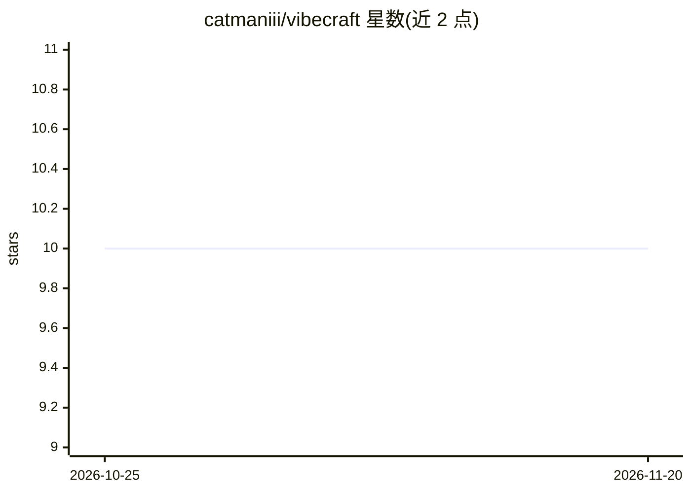

# catmaniii/vibecraft

⭐ 10 · Python · MIT · 推送 2026-10-04 · [GitHub](https://github.com/catmaniii/vibecraft) · 个人维护 · 中文 README

**用语音+文字指挥 AI bot 替你打星际争霸 II 的工具**

玩家通过手机 PWA 下达语音或文字指令，LLM（DeepSeek API）将自然语言解析为 Directives JSON，Director 每帧仲裁后经 sharpy/python-sc2 操作 StarCraft II；游戏画面与声音经 WebRTC 推回手机。面向操作跟不上但战略判断仍在的老玩家，支持三族 40+ 剧本、编队、骚扰、偷矿、代理建造等指令类型。限制：仅 Windows 10/11、Python 3.11、需正版 SC2 与自备 DeepSeek API key，server 必须与 SC2 同机。

## 筛选速览

| 维度 | 判定 | 备注 |
|---|---|---|
| AI 角色 | `ai-native` | 本体是模型或模型工具 |
| 许可风险 | `permissive` | MIT |
| 部署形态 | `desktop` | 安装包/桌面程序 |
| 模型依赖 | locked-api |  |
| 硬件要求 | — | 无带数字的原话,不猜 |
| 安装摩擦 | `low` | 无编译、无系统依赖或容器化 |
| 成熟度 | — | 结构信号不足 |

## 能力要点

- 手机 PWA 驾驶舱：实时画面 + 宏观/战术/运营面板 + 语音/文字指令输入
- LLM 解析自然语言为 Directives JSON，四层粒度指令（宏观剧本/全军战术/单位任务/产能）
- 三族 40+ 剧本库，支持编队、巡逻、侦查、偷矿、代理建造、多步串联指令
- 中文 FunASR 流式 ASR、英文 SenseVoiceSmall 离线 ASR，WebRTC 推流

## 适用场景

- 老玩家用手机下战略指令，让 bot 代打补农造兵等操作
- 朋友间远程组队开黑，自己只做指挥官
- 外网/局域网环境下通过 PWA 连接自家 PC 上的 SC2 对局

## 场景标签

`语音识别` · 领域:感知与多模态

## 证据(README 行号)

> L8: （打字 / 手机输入法语音转字 / App 内按住说话），AI（基础 bot）替你执行所有鼠标键盘操作：
> L39: > - **DEEPSEEK_API_KEY** 环境变量（LLM 解析指令用，需自备 DeepSeek API key，**按量付费**；
> L420: 一句话：**手机指令 → LLM 解析成 Directives JSON（唯一中间表示）→ Director 每帧仲裁 →

## 星数曲线

2026-10-25 10 → 2026-11-20 10（+0）

---
*卡片 v1 · prompt 1.4 · 生成 2026-11-19 · 置信度 mid · 依据 README sha `4d470ed988a8` · [字段定义](../../DATASET.md)*
