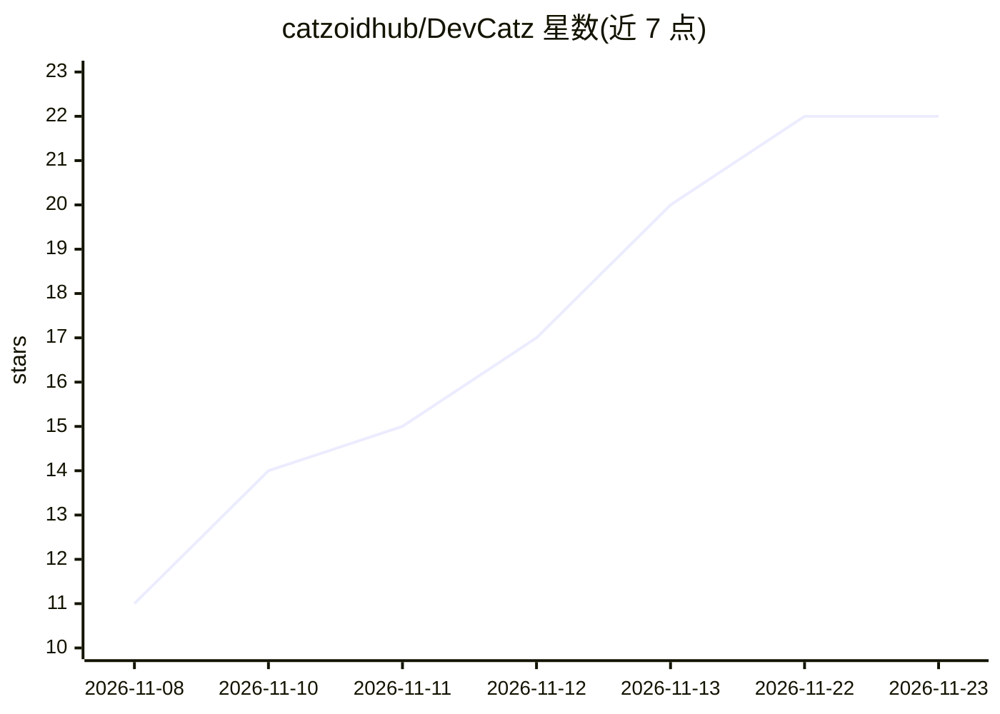

# catzoidhub/DevCatz

⭐ 22 · TypeScript · GPL-3.0 · 推送 2026-11-20 · [GitHub](https://github.com/catzoidhub/DevCatz) · [官网](https://catzoid.com/devcatz) · 个人维护

**macOS/Windows/Linux 本地开发环境应用：自动识别技术栈并一站管理**

面向开发者的本地开发环境桌面应用：拖入项目文件夹后自动检测技术栈（PHP、Node/Bun、Python、Ruby、Go、Rust 及 Laravel/Next.js/Django 等框架），为每个站点提供 https://*.localhost 可信证书域名，并集成运行时版本管理、多种数据库与存储（MySQL、PostgreSQL、Redis、MongoDB、Elasticsearch 等）、邮件捕获、隧道与 Docker 文件生成。AI 为可选功能：自带 provider 接入（Claude、OpenAI、Gemini、Ollama）且默认关闭，用于 Git AI 提交信息等。macOS 应用经 Apple 签名公证，Windows/Linux 包暂未签名。

## 筛选速览

| 维度 | 判定 | 备注 |
|---|---|---|
| AI 角色 | `ai-enhanced` | 去掉 AI 部分产品仍成立 |
| 许可风险 | `viral` | GPL-3.0 |
| 部署形态 | `desktop` | 安装包/桌面程序 |
| 模型依赖 | local-ok | 支持本地模型 |
| 硬件要求 | — | 无带数字的原话,不猜 |
| 安装摩擦 | `low` | 无编译、无系统依赖或容器化 |
| 成熟度 | — | 结构信号不足 |

## 能力要点

- 自动检测项目技术栈并按站点分配 https://*.localhost 可信证书
- 集成多运行时版本与 MySQL/PostgreSQL/Redis/MongoDB/Elasticsearch 等服务
- Docker 文件由技术栈自动生成，含日志、.env 编辑与数据库迁移管理
- AI 为可选自带 provider 功能，默认关闭

## 适用场景

- 在一个应用里管理多个本地站点及各自依赖的运行时和服务
- 为本地站点提供浏览器信任的 https://*.localhost 域名
- 通过邮件捕获、隧道等功能完成本地调试与对外预览

## 场景标签

 · 领域:开发者工具/本地开发环境

## 证据(README 行号)

> L11: A local development environment for macOS, Windows and Linux. Drop a project folder in and DevCatz works out its st
> L22: - **AI, optional** — bring your own provider (Claude, OpenAI, Gemini, Ollama …); off until you switch it on.

## 星数曲线

2026-11-08 11 → 2026-11-23 22（+11）

---
*卡片 v1 · prompt 1.4 · 生成 2026-11-18 · 置信度 high · 依据 README sha `956d039d1241` · [字段定义](../../DATASET.md)*
