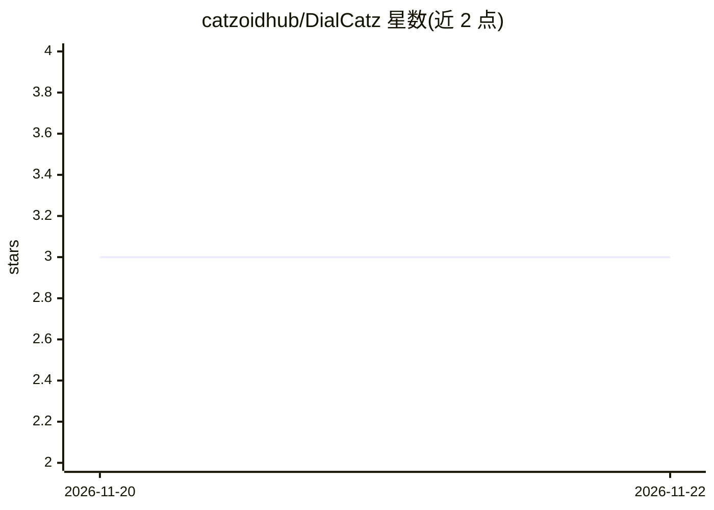

# catzoidhub/DialCatz

⭐ 3 · TypeScript · GPL-3.0 · 推送 2026-11-20 · [GitHub](https://github.com/catzoidhub/DialCatz) · [官网](https://catzoid.com/dialcatz) · 个人维护

**开源 API 客户端：REST/GraphQL/WebSocket 调试与团队共享**

跨 macOS/Windows/Linux 的 API 客户端，覆盖 HTTP、GraphQL 与 WebSocket、Socket.IO、Pusher、gRPC、SSE 等协议；集合可跟随 OpenAPI 规范、校验响应并启动本地 mock 服务器。支持环境变量、前置/测试脚本、runner 与 JSON/JUnit 导出；可导入 Postman、OpenAPI/Swagger 与 cURL，通过 Git 仓库或自托管 DialCatz Den 做团队共享，环境值保留在本地。AI 功能为可选项：解释响应、编写测试、生成请求体，仅发送名称与 URL；MCatzP 提供 155 个工具供 AI 助手操作工作区。提供 DMG/EXE/AppImage/deb 安装包及源码构建。

## 筛选速览

| 维度 | 判定 | 备注 |
|---|---|---|
| AI 角色 | `ai-enhanced` | 去掉 AI 部分产品仍成立 |
| 许可风险 | `viral` | GPL-3.0 |
| 部署形态 | `desktop` | 安装包/桌面程序 |
| 模型依赖 | — | README 未给出锁定关系 |
| 硬件要求 | — | 无带数字的原话,不猜 |
| 安装摩擦 | `low` | 无编译、无系统依赖或容器化 |
| 成熟度 | — | 结构信号不足 |

## 能力要点

- 支持 HTTP、GraphQL、WebSocket、Socket.IO、Pusher、gRPC、SSE、JSON-RPC 多协议
- OpenAPI 集合同步、响应规范校验与本地 mock 服务器（端口 4010–4099）
- Git 文件化工作区或自托管 DialCatz Den 两种团队共享方式
- 可选 AI 功能与 MCatzP（155 工具）的 AI 助手接入

## 适用场景

- 调试和测试 REST、GraphQL 与 WebSocket 等接口
- 从 Postman 或 cURL 迁移现有请求集合
- 团队通过 Git 仓库以 PR 方式评审 API 集合变更
- 依据 OpenAPI 规范校验响应并运行 mock 服务器

## 场景标签

 · 领域:开发者工具/API 测试

## 证据(README 行号)

> L11: An API client for HTTP, GraphQL and the live protocols — WebSocket, Socket.IO, Pusher, gRPC, Server-Sent Events and
> L24: - **AI, optional** — explain a response, write tests, generate a body; names and URLs only, never your secrets.
> L25: - **MCatzP** — let an AI assistant read your workspaces, send requests, follow specs and start mocks through MCatzP

## 星数曲线

2026-11-20 3 → 2026-11-22 3（+0）

---
*卡片 v1 · prompt 1.4 · 生成 2026-11-22 · 置信度 high · 依据 README sha `cecbf71ac70e` · [字段定义](../../DATASET.md)*
