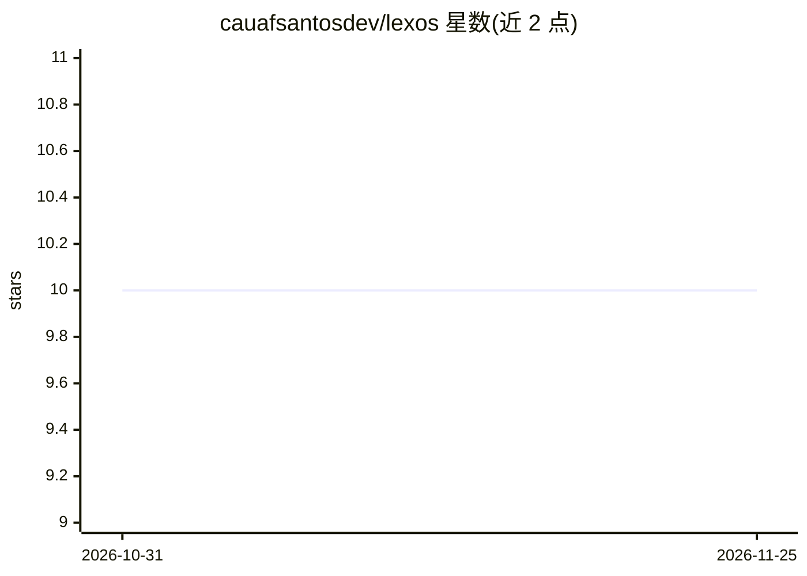

# cauafsantosdev/lexos

⭐ 10 · Go · MIT · 推送 2026-08-18 · [GitHub](https://github.com/cauafsantosdev/lexos) · [官网](https://lexos.cauafsantos.dev) · 个人维护

**自托管 AI 文档处理引擎：摘要、RAG 问答与语音转录**

基于自托管语言模型的云原生事件驱动文档处理引擎，由 Go 高并发网关与异步 Python worker 组成：文档经 SHA-256 内容寻址去重后入 Redis 队列，worker 执行 Map-Reduce 摘要（Qwen3 0.6B GGUF）、基于 FastEmbed 与 FAISS 的多语言 RAG 问答（SSE 逐 token 流式返回），以及 Faster-Whisper CPU 离线转录。全程不依赖外部 AI API，MinIO/R2 提供 S3 兼容存储。面向希望在自有环境处理文档、音频并保持数据不出本地的开发者，CPU-only VPS 约 4 vCPU/8GB 内存即可部署。

## 筛选速览

| 维度 | 判定 | 备注 |
|---|---|---|
| AI 角色 | `ai-native` | 本体是模型或模型工具 |
| 许可风险 | `permissive` | MIT |
| 部署形态 | `self-host` | docker 或自建部署 |
| 模型依赖 | local-ok | 支持本地模型 |
| 硬件要求 | `cpu-ok` | |
| 安装摩擦 | `low` | 无编译、无系统依赖或容器化 |
| 成熟度 | — | 结构信号不足 |

## 能力要点

- 摘要、RAG、转录三类管线全在本地 Docker 环境内运行，不调用外部 AI API
- SHA-256 内容寻址去重与分布式锁抑制重复推理
- SSE 经 Redis Pub/Sub 逐 token 流式输出 RAG 答案
- Q4_K_M 量化 GGUF + 内存映射加载，适配小规格 CPU 服务器

## 适用场景

- 在自有服务器上离线摘要与归档大量文档
- 对上传文档做多语言检索式问答并流式查看回答
- 将会议或访谈音频离线转录为文字

## 场景标签

`RAG` `文档问答` `语音识别` `向量数据库` · 领域:知识与检索

## 证据(README 行号)

> L14: **Lexos** is a cloud-native, event-driven AI document processing engine built around self-hosted language models. I
> L62: * **Gleaner (RAG):** Splits documents along exact tokenizer boundaries using the model’s Rust-based Hugging Face to
> L63: * **Scriber (Audio):** Processes audio files through **Faster-Whisper** for offline, CPU-optimized transcription.

## 星数曲线

2026-10-31 10 → 2026-11-25 10（+0）

---
*卡片 v1 · prompt 1.4 · 生成 2026-11-19 · 置信度 mid · 依据 README sha `5253b46515dd` · [字段定义](../../DATASET.md)*
