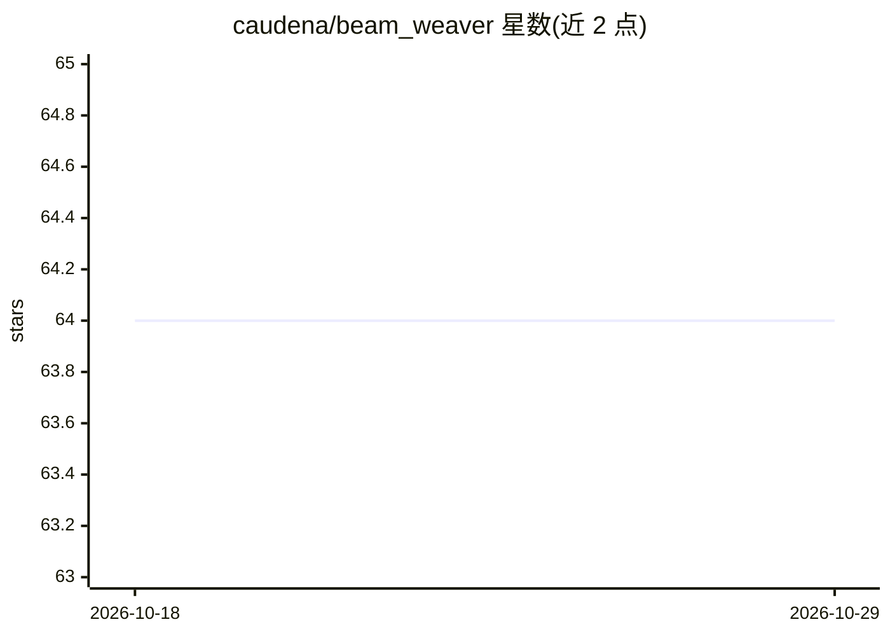

# caudena/beam_weaver

⭐ 64 · Elixir · Apache-2.0 · 推送 2026-10-19 · [GitHub](https://github.com/caudena/beam_weaver) · [官网](https://docs.weavescope.com/beamweaver) · 组织维护

**Elixir 原生的 LLM 应用与 Agent 工作流框架**

面向 Elixir 开发者的 AI agent 与持久化工作流框架：以模块声明 agent，将应用函数暴露为带类型标注的工具，用图 DSL 表达步骤、分支与并行；提供短期/长期记忆、human-in-the-loop 审批、流式输出、检查点存储与中断恢复、嵌入与向量检索。支持 OpenAI、Anthropic、Gemini、DeepSeek 等多家模型接入，另含 fake models 与 replay transport 用于确定性测试，配套 WeaveScope 追踪。以 Hex 依赖安装（1.0.0 发布后可用）。

## 筛选速览

| 维度 | 判定 | 备注 |
|---|---|---|
| AI 角色 | `ai-ecosystem` | LLM/agent 周边工具 |
| 许可风险 | `permissive` | Apache-2.0 |
| 部署形态 | `None` |  |
| 模型依赖 | locked-api |  |
| 硬件要求 | — | 无带数字的原话,不猜 |
| 安装摩擦 | `low` | 无编译、无系统依赖或容器化 |
| 成熟度 | — | 结构信号不足 |

## 能力要点

- 图 DSL 表达工作流步骤、分支与并行
- 持久检查点存储与中断工作恢复
- human-in-the-loop 在动作执行前人工审查
- fake models 与 replay transports 支持确定性应用测试

## 适用场景

- 在 Elixir 应用内构建带工具调用的 AI agent
- 搭建需要审批环节的持久化工作流
- 接入多家模型提供商并做生产级追踪与测试

## 场景标签

`Agent 框架` `Agent 记忆` `工作流自动化` · 领域:Agent 开发

## 证据(README 行号)

> L5: Build AI agents and durable workflows inside your Elixir application.
> L35: |Declare agents, typed tools and structured answers|Agents, Tools, Structured Output|

## 星数曲线

2026-10-18 64 → 2026-10-29 64（+0）

---
*卡片 v1 · prompt 1.4 · 生成 2026-10-24 · 置信度 high · 依据 README sha `a2fef689dc99` · [字段定义](../../DATASET.md)*
