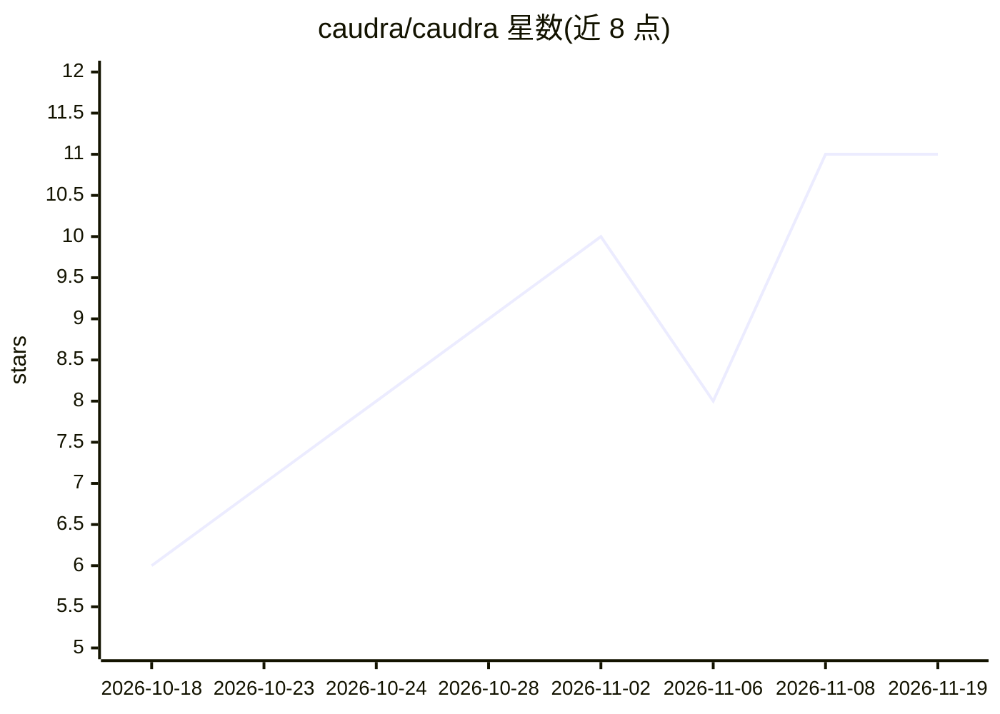

# caudra/caudra

⭐ 11 · Rust · Apache-2.0 · 推送 2026-11-04 · [GitHub](https://github.com/caudra/caudra) · [官网](https://caudra.ai) · 个人维护

**面向开发者的终端 TUI 编码 Agent，含 Autopilot 与后台子代理**

以单个原生二进制分发的终端编码 Agent：提供 /goal 目标循环、Autopilot 委托应答权限提示、内容筛选（拦截试图指令注入的网页）、搜索结果重排序、RTK 风格 shell 输出过滤与压缩、带记忆的后台学习器（写入 AGENTS.md）、后台子代理与 shell 调用、code mode 调用 MCP 服务器。支持 17 家提供商或本地模型，在 Plan 模式下仅写计划待批准。macOS/Linux/Windows 可用，Apache 2.0 许可。

## 筛选速览

| 维度 | 判定 | 备注 |
|---|---|---|
| AI 角色 | `ai-native` | 本体是模型或模型工具 |
| 许可风险 | `permissive` | Apache-2.0 |
| 部署形态 | `library` | 以包/库形式分发 |
| 模型依赖 | local-ok | 支持本地模型 |
| 硬件要求 | — | 无带数字的原话,不猜 |
| 安装摩擦 | `medium` | 含编译或系统依赖之一 |
| 成熟度 | `idea` | |

## 能力要点

- Autopilot：委托模型代答权限提示，含预算、日志与审批边界
- 内容筛选与重排序：拦截提示注入网页并优先排序相关结果
- 后台子代理与 shell 调用，主会话可随时引导运行中的任务
- 学习器将纠正写入 AGENTS.md，可通过 /learn 查看与回滚

## 适用场景

- 在终端仓库中让 Agent 制定计划并逐步实现代码改动
- 离开键盘时让 Autopilot 按完成目标持续推进会话
- 通过输出过滤与压缩降低长会话的 token 消耗
- 从 Python 代码并发调用 MCP 服务器工具

## 场景标签

`编码 Agent` · 领域:编码与开发

## 证据(README 行号)

> L15: **The complete coding agent for your terminal.**
> L17: Autopilot, a decision system for screening and reranking, built-in token savings, background subagents and shell ca
> L40: Free and open source under the Apache License 2.0. Runs on macOS, Linux, and Windows. Works with 17 providers, or a

## 星数曲线

2026-10-18 6 → 2026-11-19 11（+5）

---
*卡片 v1 · prompt 1.4 · 生成 2026-11-18 · 置信度 high · 依据 README sha `5ccc0e62f3fd` · [字段定义](../../DATASET.md)*
