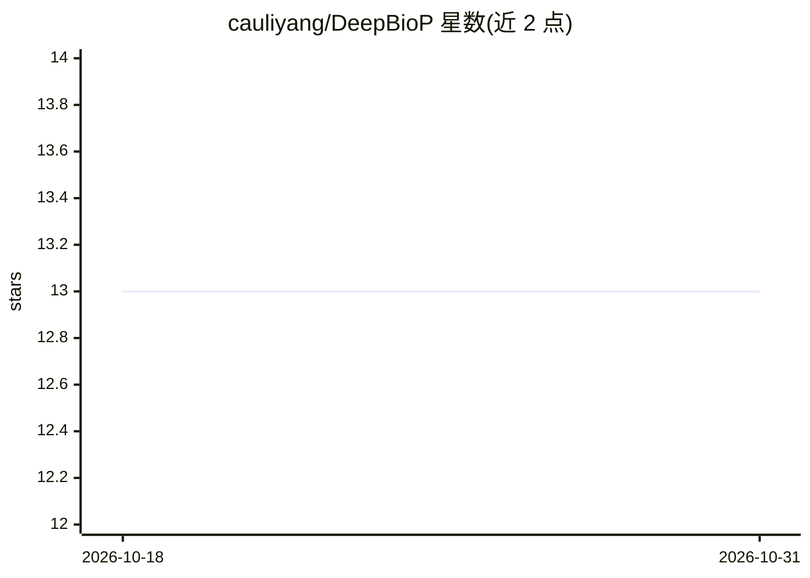

# cauliyang/DeepBioP

⭐ 13 · Rust · Apache-2.0 · 推送 2026-10-27 · [GitHub](https://github.com/cauliyang/DeepBioP) · [官网](http://yangyangli.top/DeepBioP/) · 个人维护

**面向生物数据的深度学习预处理库（Rust/Python/CLI）**

为基因组等生物数据提供深度学习前处理能力的库：支持 DNA 序列 One-Hot/K-mer/整数编码、FASTQ/FASTA/BAM/VCF/GTF 等格式的读写与特征提取、反向互补与突变模拟等数据增强、Parquet/NumPy 导出，并提供 PyTorch 风格的 Dataset/DataLoader 接口。底层用 Rust 实现并以 PyO3 提供 Python 绑定，另有 Rust crate 与 dbp 命令行三种接口，支持流式处理 100GB+ 文件与 rayon 并行。面向生物信息学与深度学习交叉领域的研究者和开发者。

## 筛选速览

| 维度 | 判定 | 备注 |
|---|---|---|
| AI 角色 | `ai-ecosystem` | LLM/agent 周边工具 |
| 许可风险 | `permissive` | Apache-2.0 |
| 部署形态 | `library` | 以包/库形式分发 |
| 模型依赖 | — | README 未给出锁定关系 |
| 硬件要求 | — | 无带数字的原话,不猜 |
| 安装摩擦 | `low` | 无编译、无系统依赖或容器化 |
| 成熟度 | — | 结构信号不足 |

## 能力要点

- One-Hot/K-mer/整数三种序列编码，支持批量并行（1M+ 序列/秒）
- FASTQ/FASTA/BAM/SAM/VCF/GTF/GFF 读写、转换与特征提取
- 反向互补、随机突变、质量模拟等可复现数据增强（种子控制）
- PyTorch 风格 Dataset/DataLoader 与 Parquet/NumPy 零拷贝导出

## 适用场景

- 将 FASTQ/BAM 测序数据编码后喂给 PyTorch 训练流程
- 对 DNA 序列做反向互补、突变模拟等训练数据增强
- 在命令行批量转换与导出生物数据到分析格式

## 场景标签

 · 领域:生物信息学/机器学习数据处理

## 证据(README 行号)

> L10: Deep Learning Processing Library for Biological Data
> L49: ## 🐍 Python API + 🦀 Rust Library + 🔧 CLI Tool

## 星数曲线

2026-10-18 13 → 2026-10-31 13（+0）

---
*卡片 v1 · prompt 1.4 · 生成 2026-10-31 · 置信度 high · 依据 README sha `a930ccf5502e` · [字段定义](../../DATASET.md)*
