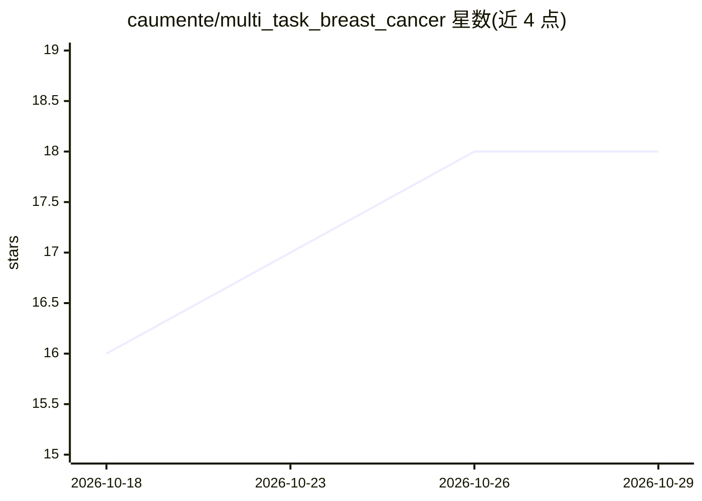

# caumente/multi_task_breast_cancer

⭐ 18 · Python · Apache-2.0 · 推送 2026-03-20 · [GitHub](https://github.com/caumente/multi_task_breast_cancer) · 组织维护

**乳腺超声多任务深度学习框架：同时做分割与良恶性分类**

科研代码仓库，附随论文发布：多任务学习框架同时处理乳腺超声图像的分割与三分类（normal/benign/malignant），骨干网络可用 U-Net++ 或 nnU-Net，含确定性过采样与预测精炼模块，损失为 dice+focal 加权和。另提出基于 SSIM 的重复图像识别算法，从 BUSI 数据集 780 张图像中移除 330 例重复，发布 Curated BUSI（450 张）。提供 git clone 后的数据预处理与训练脚本（python -m src.training_multitask）。

## 筛选速览

| 维度 | 判定 | 备注 |
|---|---|---|
| AI 角色 | `ai-native` | 本体是模型或模型工具 |
| 许可风险 | `permissive` | Apache-2.0 |
| 部署形态 | `None` |  |
| 模型依赖 | — | README 未给出锁定关系 |
| 硬件要求 | — | 无带数字的原话,不猜 |
| 安装摩擦 | `low` | 无编译、无系统依赖或容器化 |
| 成熟度 | — | 结构信号不足 |

## 能力要点

- 同时输出超声图像分割掩码与三类分类的多任务模型
- SSIM 重复图像识别算法并发布 Curated BUSI 数据集（450 张）
- 确定性过采样与预测精炼模块，dice+focal 组合损失
- 支持 U-Net++ / nnU-Net 骨干网络

## 适用场景

- 复现论文中的多任务乳腺超声分割与分类实验
- 在 Curated BUSI 上训练或评测乳腺超声模型
- 研究多任务学习在医学影像 CAD 系统中的应用

## 场景标签

 · 领域:医学影像/计算机辅助诊断

## 证据(README 行号)

> L1: # A multi-task framework for breast cancer segmentation and classification in ultrasound imaging
> L21: - We built a CAD system for breast cancer that exploits the existing correlations between segmentation and classifi
> L47: The proposed framework is a multi-task learning model designed to simultaneously handle breast cancer segmentation 

## 星数曲线

2026-10-18 16 → 2026-10-29 18（+2）

---
*卡片 v1 · prompt 1.4 · 生成 2026-10-29 · 置信度 high · 依据 README sha `c38ebe4b6d3b` · [字段定义](../../DATASET.md)*
