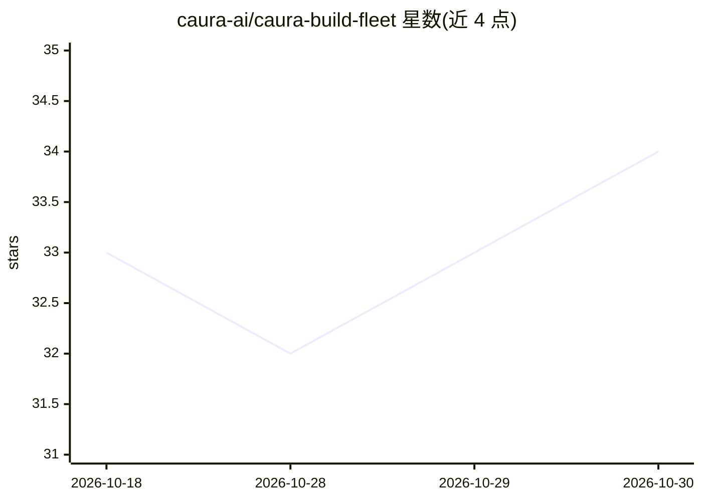

# caura-ai/caura-build-fleet

⭐ 34 · Python · Apache-2.0 · 推送 2026-10-22 · [GitHub](https://github.com/caura-ai/caura-build-fleet) · 组织维护

**多 Agent 共享记忆流水线参考实现：5 专家经 MCP 传递约束**

基于 MemClaw 共享记忆平台的可运行参考实现：5 个专家 Agent（Frontend/Performance/SEO/Code Review/Manager）组成流水线，通过 MCP 协议共享 fleet 记忆，上游 Agent 的决策自动约束下游行为（约束传播）。提供混合检索（向量+关键词+知识图）、fleet 命名空间隔离、行级安全、矛盾检测与审计日志。每个 Agent 有 MCP 工具白名单实现最小权限。需 MemClaw 账号与支持函数调用的 LLM，可选托管云 LLM 或本地 Ollama；Manager/Code Review 需一次性提升 trust_level=2 才能跨 Agent 查询。

## 筛选速览

| 维度 | 判定 | 备注 |
|---|---|---|
| AI 角色 | `ai-ecosystem` | LLM/agent 周边工具 |
| 许可风险 | `permissive` | Apache-2.0 |
| 部署形态 | `library` | 以包/库形式分发 |
| 模型依赖 | local-ok | 支持本地模型 |
| 硬件要求 | — | 无带数字的原话,不猜 |
| 安装摩擦 | `low` | 无编译、无系统依赖或容器化 |
| 成熟度 | — | 结构信号不足 |

## 能力要点

- 5 个专家 Agent 经 MCP 共享 fleet 记忆实现约束传播
- 混合检索：向量+关键词+知识图遍历单次调用
- 每 Agent MCP 工具白名单，Manager 只读验证数据隔离
- 矛盾检测与审计日志，支持 fleet/tenant/agent 三级隔离

## 适用场景

- 学习多 Agent 共享记忆与约束传播的实现模式
- 克隆后改造成自己领域的 Agent 流水线
- 评估 MemClaw 记忆平台在多 Agent 协调中的用法

## 场景标签

`Agent 记忆` `多智能体` · 领域:Agent 开发

## 证据(README 行号)

> L5: **A runnable reference implementation of multi-agent constraint propagation using MemClaw.**
> L17: MemClaw is a governed shared memory platform built for AI agent fleets. It's not a vector database bolted onto your
> L19: > **New to MCP?** MCP (Model Context Protocol) is an open standard that lets LLMs call external tools via a consist

## 星数曲线

2026-10-18 33 → 2026-10-30 34（+1）

---
*卡片 v1 · prompt 1.4 · 生成 2026-10-25 · 置信度 mid · 依据 README sha `1ad2e6fba408` · [字段定义](../../DATASET.md)*
