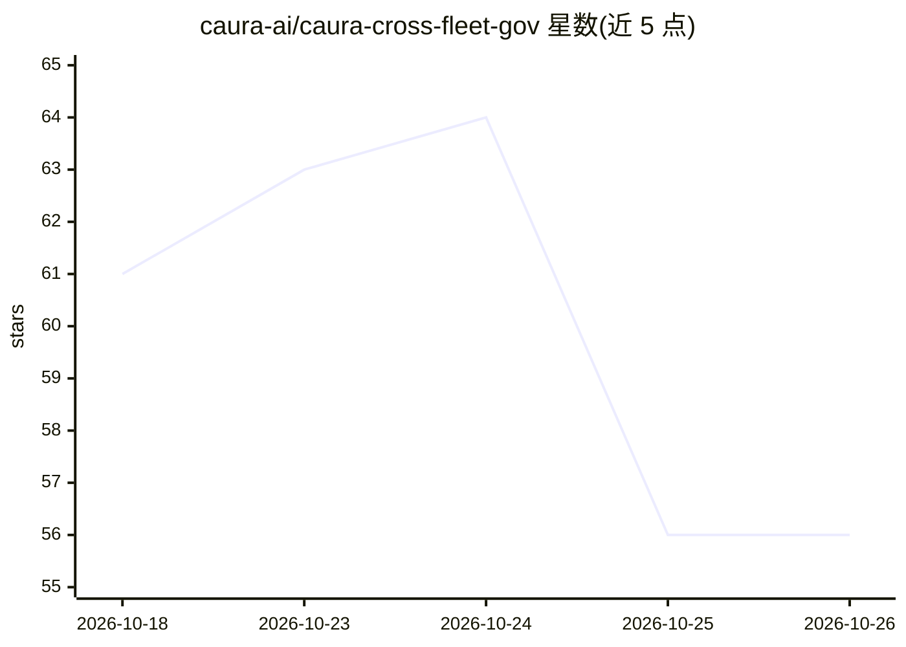

# caura-ai/caura-cross-fleet-gov

⭐ 56 · PowerShell · MIT · 推送 2026-09-14 · [GitHub](https://github.com/caura-ai/caura-cross-fleet-gov) · 组织维护

**多智能体共享记忆的舰队级隔离治理演示（MemClaw+OpenClaw）**

基于 MemClaw 与 OpenClaw 编排网关的用例实现：Sales、Legal、Admin 三个 agent 共用同一 MemClaw 记忆后端，按 fleet_id 在查询层用 WHERE 谓词强制隔离，写入时由 LLM 自动分类、生成摘要/标签、扫描 PII、检测冲突。支持混合召回（向量+关键词+知识图）、8 状态生命周期、审计日志与跨舰队综合。限制：OSS 本地部署中舰队边界依赖 agent 如实声明 fleet_ids，硬隔离需多租户或托管服务；本仓库为演示，非生产部署。

## 筛选速览

| 维度 | 判定 | 备注 |
|---|---|---|
| AI 角色 | `ai-ecosystem` | LLM/agent 周边工具 |
| 许可风险 | `permissive` | MIT |
| 部署形态 | `self-host` | docker 或自建部署 |
| 模型依赖 | — | README 未给出锁定关系 |
| 硬件要求 | — | 无带数字的原话,不猜 |
| 安装摩擦 | `low` | 无编译、无系统依赖或容器化 |
| 成熟度 | — | 结构信号不足 |

## 能力要点

- 查询层 WHERE fleet_id IN (...) 谓词在混合检索前执行，边界非提示词约定
- 写入时 LLM 自动富化：分类/标题/标签/PII 扫描/实体抽取/矛盾检测
- per-row scope_agent ACL 与全量读写审计日志
- 8 状态记忆生命周期与 Crystallizer 近重复合并（含溯源）

## 适用场景

- 验证多 agent 场景下 Sales/Legal 记忆隔离与 Admin 跨舰队综合
- 学习 MemClaw 记忆治理机制（舰队边界、ACL、审计）的部署方式
- 评估 OSS 自托管与托管服务在隔离强度上的差异

## 场景标签

`Agent 记忆` `多智能体` · 领域:Agent 开发

## 证据(README 行号)

> L26: MemClaw is open-source multi-agent memory for AI agent fleets: governed, shared, and self-improving. Agents write p
> L42: This repo is a **use-case implementation**: three OpenClaw agents (Sales, Legal, Admin) operating against a single 
> L61: npm install -g openclaw@latest

## 星数曲线

2026-10-18 61 → 2026-10-26 56（-5）

---
*卡片 v1 · prompt 1.4 · 生成 2026-10-24 · 置信度 low · 依据 README sha `b594474a560d` · [字段定义](../../DATASET.md)*
