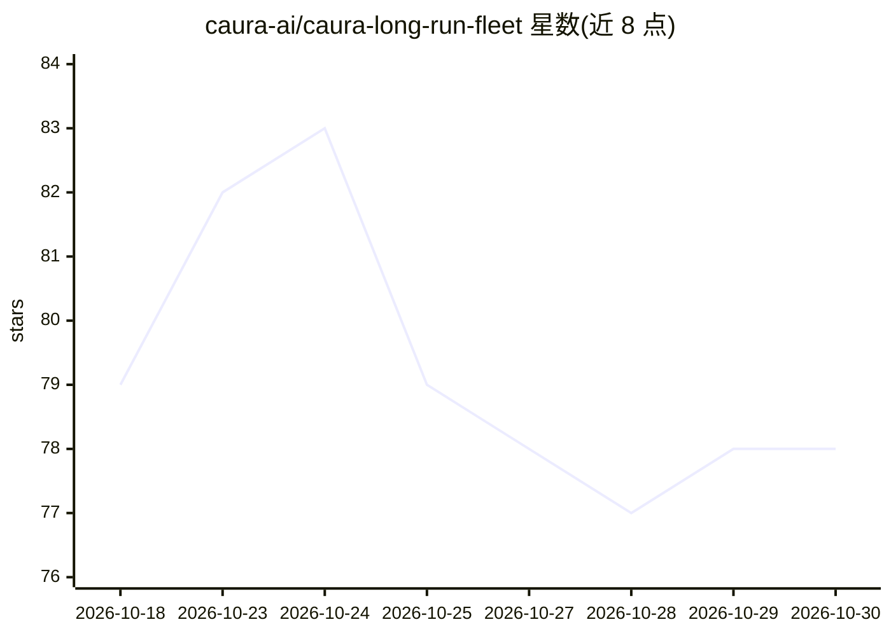

# caura-ai/caura-long-run-fleet

⭐ 78 · Python · MIT · 推送 2026-10-22 · [GitHub](https://github.com/caura-ai/caura-long-run-fleet) · [官网](https://caura.ai) · 组织维护

**演示多 Agent 共享治理记忆的参考舰队示例（Caura）**

Caura（开源 Agent 共享记忆层，曾名 MemClaw）官方维护的可运行参考示例：三个 OpenClaw agent（sourcing/verification/synthesis）通过同一 fleet_id 读写共享记忆池，演示归属标记、治理化召回、异步矛盾检测与取代链。simulate.py 模拟 14 天流程，Day 9 价格变化触发矛盾检测轮询。运行需 Python 3.9+、Node 18+、OpenClaw、自托管或托管 Caura 部署及 OpenAI 兼容 LLM 端点；本身是示例工程而非通用产品。

## 筛选速览

| 维度 | 判定 | 备注 |
|---|---|---|
| AI 角色 | `ai-ecosystem` | LLM/agent 周边工具 |
| 许可风险 | `permissive` | MIT |
| 部署形态 | `self-host` | docker 或自建部署 |
| 模型依赖 | — | README 未给出锁定关系 |
| 硬件要求 | — | 无带数字的原话,不猜 |
| 安装摩擦 | `low` | 无编译、无系统依赖或容器化 |
| 成熟度 | — | 结构信号不足 |

## 能力要点

- 三 agent 共享 fleet 记忆池，读写携带 agent_id、按 fleet_id 限定范围
- 新事实异步矛盾检测与取代链，被取代记录移出默认召回面
- REST 轮询 GET /memories/{id}/contradictions 等待证据后再合成
- 保留 MemClaw 旧标识符兼容（插件 ID、环境变量回退）

## 适用场景

- 了解多 Agent 共享记忆与矛盾治理的工作方式
- 作为 Caura 记忆层的集成参考实现
- 验证自托管或托管 Caura 部署的 fleet 流程

## 场景标签

`Agent 记忆` `多智能体` · 领域:Agent 开发

## 证据(README 行号)

> L25: Caura is an open-source, governed shared-memory layer for AI agent fleets. This example runs three OpenClaw agents 
> L49: OpenClaw routes prompts to the named agents and exposes Caura's current MCP tools:
> L90: git clone https://github.com/caura-ai/caura.git

## 星数曲线

2026-10-18 79 → 2026-10-30 78（-1）

---
*卡片 v1 · prompt 1.4 · 生成 2026-10-24 · 置信度 mid · 依据 README sha `3188d392956c` · [字段定义](../../DATASET.md)*
