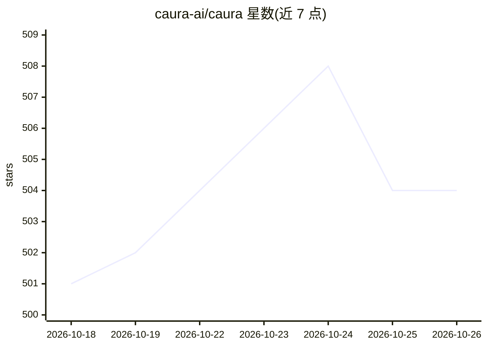

# caura-ai/caura

⭐ 504 · Python · Apache-2.0 · 推送 2026-10-25 · [GitHub](https://github.com/caura-ai/caura) · [官网](https://caura.ai) · 组织维护

**面向多智能体舰队的管理式共享记忆层**

开源的多租户、多智能体 AI 舰队记忆系统（前身 MemClaw）：agent 写入纯文本后由服务端单次 LLM 调用完成记忆分类、标题摘要生成、重要性评分、PII 标记与实体抽取；检索采用 pgvector 语义相似度 + 全文关键词 + 知识图谱扩展（最多 2 跳）的混合搜索。治理机制包括租户隔离、三级可见范围（agent/team/org）、四级 agent 信任等级与全量审计日志。部署形态覆盖托管平台、Docker 自托管、OpenClaw 插件与 Rail SDK（Python/TypeScript），通过 MCP 与 REST 接入；无 API key 的 standalone 模式仅支持关键词检索。README 同时说明公共基准（LoCoMo 等）测的是单 agent 场景，舰队治理尚需环境内验证。

## 筛选速览

| 维度 | 判定 | 备注 |
|---|---|---|
| AI 角色 | `ai-ecosystem` | LLM/agent 周边工具 |
| 许可风险 | `permissive` | Apache-2.0 |
| 部署形态 | `self-host` | docker 或自建部署 |
| 模型依赖 | — | README 未给出锁定关系 |
| 硬件要求 | — | 无带数字的原话,不猜 |
| 安装摩擦 | `low` | 无编译、无系统依赖或容器化 |
| 成熟度 | — | 结构信号不足 |

## 能力要点

- 单次 LLM 调用完成写入时的记忆分类/摘要/重要性评分/PII 标记/实体抽取
- pgvector + 全文检索 + 知识图谱扩展（2 跳）的混合搜索
- 租户隔离、三级可见范围、四级信任等级与全量审计日志
- MCP/REST 接入，提供 Python/TypeScript 客户端与 Rail SDK

## 适用场景

- 多智能体团队让一个 agent 学到的经验被其他 agent 复用
- 需要租户隔离与审计的 agent 记忆管理
- 在 OpenClaw 舰队中以插件方式挂载共享记忆
- 给自研 agent 每轮对话前注入相关规则与事实（Rail SDK）

## 场景标签

`Agent 记忆` `多智能体` · 领域:Agent 开发

## 证据(README 行号)

> L26: Caura — formerly MemClaw — is open-source memory for **multi-tenant, multi-agent** AI fleets. Your agents store wha
> L243: ### Memory Pipeline

## 星数曲线

2026-10-18 501 → 2026-10-26 504（+3）

---
*卡片 v1 · prompt 1.4 · 生成 2026-10-21 · 置信度 high · 依据 README sha `94bbf4d97714` · [字段定义](../../DATASET.md)*
