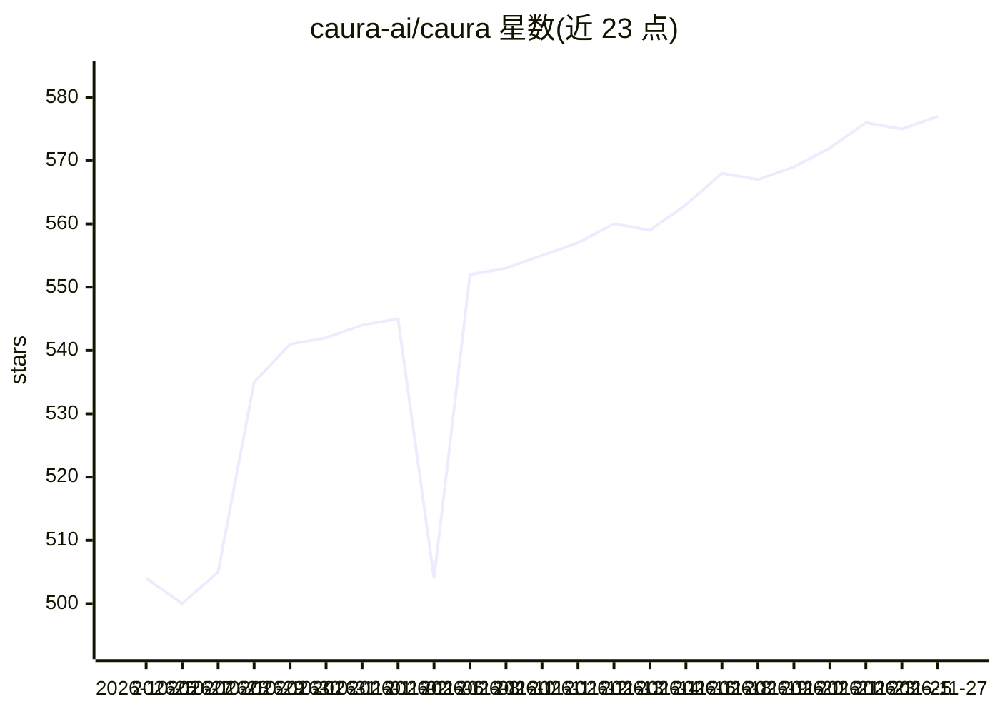

# caura-ai/caura

⭐ 577 · Python · Apache-2.0 · 推送 2026-11-26 · [GitHub](https://github.com/caura-ai/caura) · [官网](https://caura.ai) · 组织维护

**为多租户多 agent 集群提供受治理共享记忆的服务层**

开源的 AI agent 集群共享记忆层：agent 写入文本，系统经单趟 LLM 富化生成记忆类型、标题、摘要、重要性评分与 PII 标记，检索时用 pgvector 语义相似度加全文关键词加知识图谱（最多 2 跳）混合排序。治理机制包括租户行级隔离、三级可见范围、四级 agent 信任档位与完整审计日志。部署路径有托管平台、Docker 自托管、OpenClaw 插件，另有 Python/TypeScript 客户端与 Rail SDK（每轮回调前取规则与事实、轮后写回）。无 API key 时退化为关键词匹配的本地启发式模式。

## 筛选速览

| 维度 | 判定 | 备注 |
|---|---|---|
| AI 角色 | `ai-ecosystem` | LLM/agent 周边工具 |
| 许可风险 | `permissive` | Apache-2.0 |
| 部署形态 | `self-host` | docker 或自建部署 |
| 模型依赖 | — | README 未给出锁定关系 |
| 硬件要求 | — | 无带数字的原话,不猜 |
| 安装摩擦 | `low` | 无编译、无系统依赖或容器化 |
| 成熟度 | — | 结构信号不足 |

## 能力要点

- 写-取-复合三支柱：单 agent 写入的经验可被同集群其他 agent 召回复用
- 混合检索：pgvector 语义 + 全文关键词 + 知识图谱扩展（≤2 跳），被替换记忆不会排在替换项之上
- 治理：租户隔离、scope_agent/team/org 可见性、四级信任档位、全量审计日志
- Rail SDK 在每轮 agent 运行前后自动取回上下文并写回所学，临时失败进 outbox 重放

## 适用场景

- 让部署 agent、运维 agent 共享同一集群里的操作经验与回滚手册
- 自托管部署满足隐私、本地化或隔离网络的记忆存储需求
- 为自研 agent 在每轮对话前注入相关规则与事实（Rail SDK）
- 多租户 SaaS 中按租户隔离并审计各 agent 的记忆读写

## 场景标签

`Agent 记忆` `多智能体` `知识图谱` · 领域:Agent 开发

## 证据(README 行号)

> L24: ## Caura (formerly MemClaw) — the shared governed memory layer for AI agent fleets
> L26: Caura — formerly MemClaw — is open-source memory for **multi-tenant, multi-agent** AI fleets. Your agents store wha
> L240: - **Visibility scopes** — every memory is stamped at write time: `scope_agent` (private), `scope_team` (fleet-wide

## 星数曲线

2026-10-25 504 → 2026-11-27 577（+73）

---
*卡片 v1 · prompt 1.4 · 生成 2026-11-25 · 置信度 high · 依据 README sha `7aae19f2026a` · [字段定义](../../DATASET.md)*
