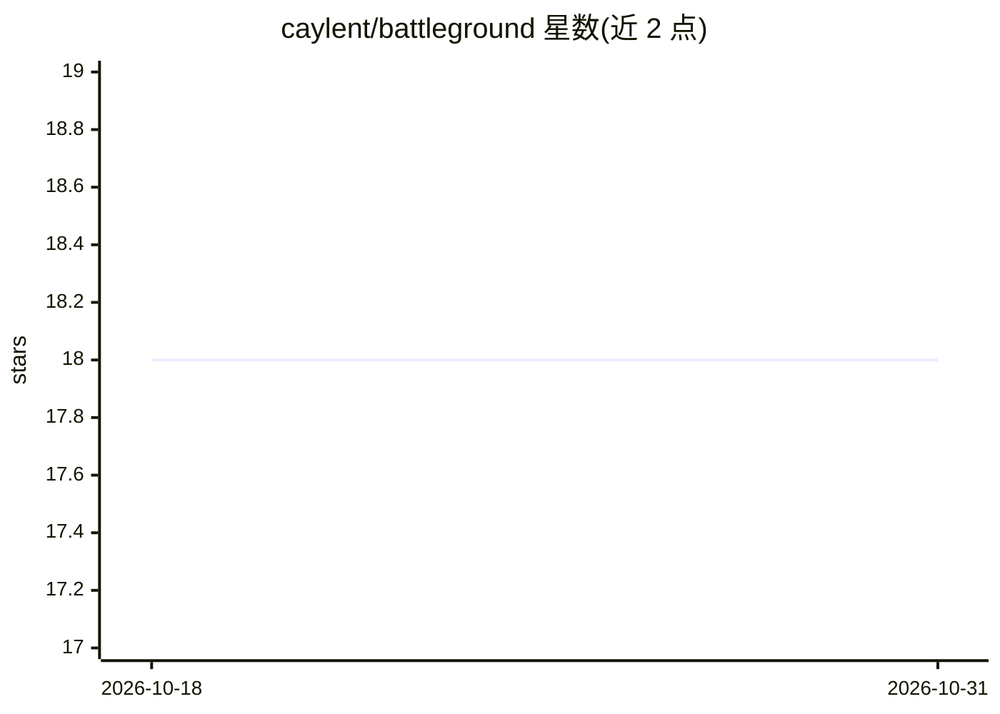

# caylent/battleground

⭐ 18 · TypeScript · MIT · 推送 2026-10-21 · [GitHub](https://github.com/caylent/battleground) · [官网](https://battleground.caylent.com) · 组织维护

**供开发者在本地对比试用 Amazon Bedrock 各 LLM 的 Web 界面**

基于 Next.js/React/TypeScript 构建的 Web 应用，用于探索和对比 Amazon Bedrock 上的大语言模型：可并排评估模型的速度、性能与成本，使用 Bedrock 的图像生成能力生成并对比视觉输出，并支持提示词创建编辑与实时性能指标可视化。使用前需配置 AWS 账号、具备 Bedrock 权限的 IAM 凭证并申请模型访问。安装方式为 git clone 源码后 npm install 并运行开发服务器。项目自述处于活跃开发中，部分功能可能不完整或有 bug。

## 筛选速览

| 维度 | 判定 | 备注 |
|---|---|---|
| AI 角色 | `ai-ecosystem` | LLM/agent 周边工具 |
| 许可风险 | `permissive` | MIT |
| 部署形态 | `library` | 以包/库形式分发 |
| 模型依赖 | locked-api |  |
| 硬件要求 | — | 无带数字的原话,不猜 |
| 安装摩擦 | `low` | 无编译、无系统依赖或容器化 |
| 成熟度 | `idea` | |

## 能力要点

- 并排对比 Bedrock LLM 的速度、性能与成本
- 调用 Bedrock 图像生成能力生成并对比视觉输出
- 提示词创建、编辑与实验功能
- 实时交互界面与性能指标可视化（Recharts）

## 适用场景

- 我在多个 Bedrock 模型间做选型，需要并排对比输出与成本
- 试验和打磨提示词并观察不同模型的响应
- 对比不同 Bedrock 图像生成模型的视觉输出

## 场景标签

`提示工程` `图像生成` `模型评测` · 领域:Agent 开发

## 证据(README 行号)

> L3: Battleground is a powerful tool designed to help developers and AI enthusiasts explore and compare Amazon Bedrock's 
> L5: - Model Comparison: Evaluate and compare the speed, performance, and cost of different Bedrock LLM models side by si

## 星数曲线

2026-10-18 18 → 2026-10-31 18（+0）

---
*卡片 v1 · prompt 1.4 · 生成 2026-10-29 · 置信度 high · 依据 README sha `de2e3cedbb5c` · [字段定义](../../DATASET.md)*
