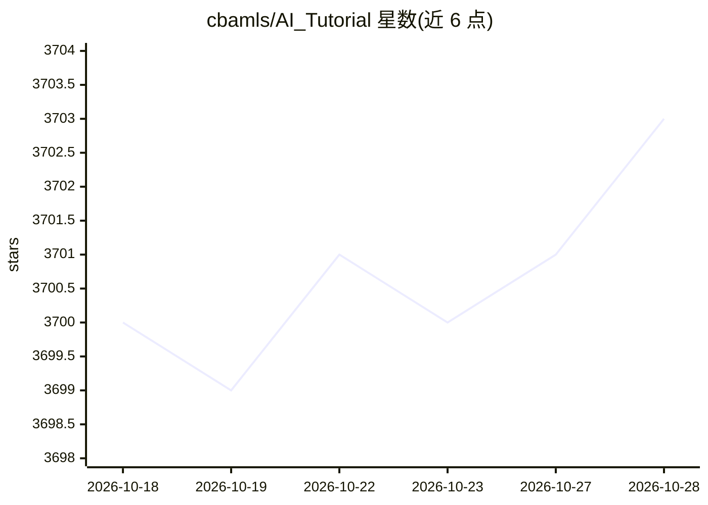

# cbamls/AI_Tutorial

⭐ 3,703 · 推送 2026-06-09 · [GitHub](https://github.com/cbamls/AI_Tutorial) · [官网](https://www.6aiq.com) · 组织维护 · 中文 README

**AI/ML 工程实践与前沿资料的聚合知识库**

AIQ 是一个 AI/ML/大数据技术资料聚合项目，内容来自 FAANG、阿里、美团、字节等大厂技术博客、arXiv、Papers With Code、Google/Meta/Microsoft Research、InfoQ、Stack Overflow、GitHub 及技术公众号（DataFunTalk、阿里技术等），每天自动更新。内容板块包括已上线的『AI 业界实践』与『AI 精选产品导航』，以及建设中的『AI 动态资讯』。内容方针为质量优先、来源可溯、经验导向，每篇内容保留原始出处。以 GitHub 仓库与网站形式提供。

## 筛选速览

| 维度 | 判定 | 备注 |
|---|---|---|
| AI 角色 | `ai-knowledge` | 知识聚合/清单类 |
| 许可风险 | `none` | — |
| 部署形态 | `None` |  |
| 模型依赖 | — | README 未给出锁定关系 |
| 硬件要求 | — | 无带数字的原话,不猜 |
| 安装摩擦 | `low` | 无编译、无系统依赖或容器化 |
| 成熟度 | — | 结构信号不足 |

## 能力要点

- 收录大厂一线工程师落地实践与顶尖实验室论文
- 每天自动更新，来源覆盖 arXiv / 大厂博客 / 技术社区 / 公众号
- 每篇内容保留原始出处
- 附带 AI 精选产品导航站点

## 适用场景

- AI 工程师查找一线落地经验与踩坑记录
- 跟踪论文、新模型发布等 AI 领域动态
- 寻找经筛选的 AI 工具与产品

## 场景标签

`精选清单` · 领域:学习与行业

## 证据(README 行号)

> L7:  AIQ 专注于此，全面整理高质量的 AI / ML / 大数据技术资料，内容来自：
> L31: |🏢 AI 业界实践|FAANG、阿里、美团、字节等大厂一线工程师的真实落地经验。不造神话，只讲干货。|✅ 已上线|
> L46: - **质量优先**：只收录有实质性工程价值或学术贡献的内容，拒绝标题党与营销软文。

## 星数曲线

2026-10-18 3,700 → 2026-10-28 3,703（+3）

---
*卡片 v1 · prompt 1.4 · 生成 2026-10-20 · 置信度 high · 依据 README sha `693e85323adb` · [字段定义](../../DATASET.md)*
