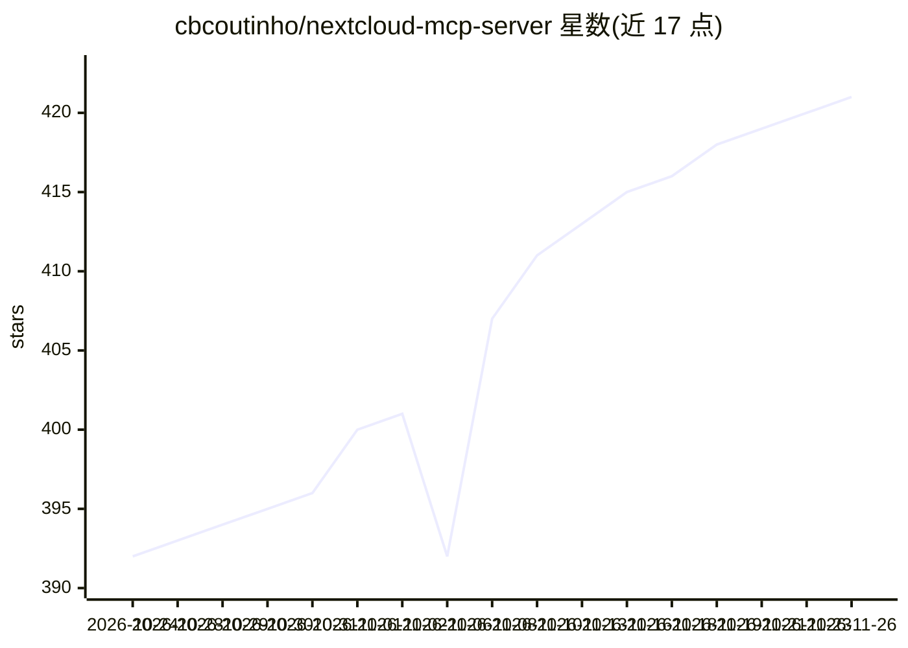

# cbcoutinho/nextcloud-mcp-server

⭐ 421 · Python · AGPL-3.0 · 推送 2026-11-25 · [GitHub](https://github.com/cbcoutinho/nextcloud-mcp-server) · 个人维护

**连接 AI 助手与 Nextcloud 实例的独立 MCP 服务器**

为外部 MCP 客户端（如 Claude Code、IDE、桌面客户端）提供访问 Nextcloud 数据的独立 MCP 服务器，可脱离 Nextcloud 以 Docker、VM、Kubernetes 或本地方式运行。覆盖 14 个 Nextcloud 应用的 110+ 工具，提供笔记、日历、联系人、文件、邮件等 CRUD 操作与 MCP Resources。支持 Basic Auth 应用密码与 Login Flow v2 多用户 OAuth 认证、按系统标签排除敏感文件。实验性语义检索（RAG）默认关闭，需额外部署 Qdrant 与嵌入服务。

## 筛选速览

| 维度 | 判定 | 备注 |
|---|---|---|
| AI 角色 | `ai-ecosystem` | LLM/agent 周边工具 |
| 许可风险 | `viral` | AGPL-3.0 |
| 部署形态 | `self-host` | docker 或自建部署 |
| 模型依赖 | local-ok | 支持本地模型 |
| 硬件要求 | — | 无带数字的原话,不猜 |
| 安装摩擦 | `low` | 无编译、无系统依赖或容器化 |
| 成熟度 | — | 结构信号不足 |

## 能力要点

- 110+ MCP 工具覆盖 14 个 Nextcloud 应用
- 文档处理：对 PDF、DOCX、图片进行 OCR 与文本提取
- Login Flow v2 多用户 OAuth 认证与应用密码透明处理
- 实验性语义检索需 Qdrant 与嵌入服务（默认关闭）

## 适用场景

- 让 Claude 等 MCP 客户端用自然语言管理我的 Nextcloud 笔记、日历与文件
- 在团队 Nextcloud 上为多用户提供带 OAuth 认证的 AI 数据访问
- 对 Nextcloud 中的文档做语义检索而非关键词搜索

## 场景标签

`语义搜索` `OCR` · 领域:知识与检索

## 证据(README 行号)

> L7: **A production-ready MCP server that connects AI assistants to your Nextcloud instance.**
> L11: This is a **dedicated standalone MCP server** designed for external MCP clients like Claude Code and IDEs. It runs 
> L60: - **110+ MCP Tools** - Comprehensive API coverage across 10 Nextcloud apps

## 星数曲线

2026-10-24 392 → 2026-11-26 421（+29）

---
*卡片 v1 · prompt 1.4 · 生成 2026-11-26 · 置信度 high · 依据 README sha `e40ecc1ba273` · [字段定义](../../DATASET.md)*
