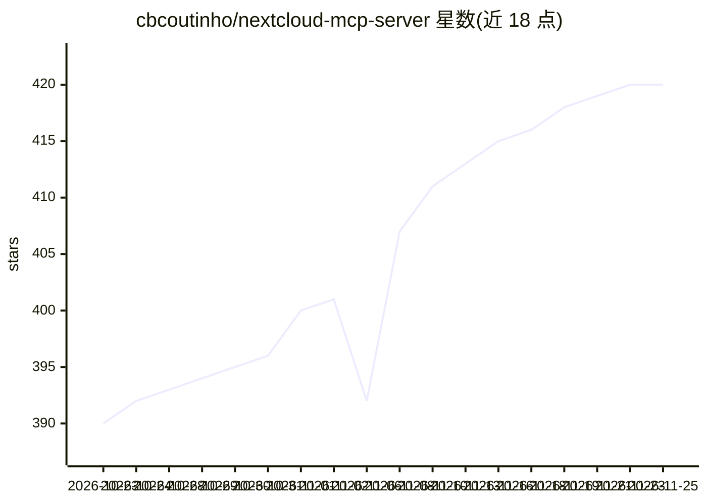

# cbcoutinho/nextcloud-mcp-server

⭐ 420 · Python · AGPL-3.0 · 推送 2026-11-23 · [GitHub](https://github.com/cbcoutinho/nextcloud-mcp-server) · 个人维护

**把 Nextcloud 数据经 MCP 接入 AI 助手的服务器**

独立运行的 Model Context Protocol 服务器，向 Claude Code、IDE 等外部 MCP 客户端开放 Nextcloud 数据的 CRUD 操作，覆盖 Notes、Calendar、Contacts、Files、Deck、Mail、Talk 等 14 个应用、110+ 工具。部署方式含 uvx 本地运行、Docker、Kubernetes Helm chart；认证支持应用密码 Basic Auth 与多用户 Login Flow v2。另有实验性语义搜索（RAG）管道，默认关闭，需自备 Qdrant 与嵌入服务；Astrolabe Cloud 为开发中的托管服务。AGPL-3.0 许可。

## 筛选速览

| 维度 | 判定 | 备注 |
|---|---|---|
| AI 角色 | `ai-ecosystem` | LLM/agent 周边工具 |
| 许可风险 | `viral` | AGPL-3.0 |
| 部署形态 | `self-host` | docker 或自建部署 |
| 模型依赖 | local-ok | 支持本地模型 |
| 硬件要求 | — | 无带数字的原话,不猜 |
| 安装摩擦 | `low` | 无编译、无系统依赖或容器化 |
| 成熟度 | `idea` | |

## 能力要点

- 110+ MCP 工具覆盖 14 个 Nextcloud 应用的 CRUD 操作
- 多用户 Login Flow v2：客户端经 OAuth 认证，服务端透明处理应用密码
- 实验性语义搜索管道（可选 Qdrant + 嵌入服务）与重排序文档
- 支持 streamable-http 与 stdio 两种传输方式

## 适用场景

- 让 Claude Desktop 或 IDE 通过自然语言管理 Nextcloud 笔记、日历、联系人
- 对企业文件做 OCR 与文本提取后供 MCP 客户端检索
- 多用户环境接入 Nextcloud 内容并按用户身份隔离访问

## 场景标签

`知识库管理` `RAG` `OCR` · 领域:知识与检索

## 证据(README 行号)

> L11: This is a **dedicated standalone MCP server** designed for external MCP clients like Claude Code and IDEs. It runs 
> L60: - **110+ MCP Tools** - Comprehensive API coverage across 10 Nextcloud apps

## 星数曲线

2026-10-23 390 → 2026-11-25 420（+30）

---
*卡片 v1 · prompt 1.4 · 生成 2026-11-25 · 置信度 mid · 依据 README sha `d5ca4c67e895` · [字段定义](../../DATASET.md)*
