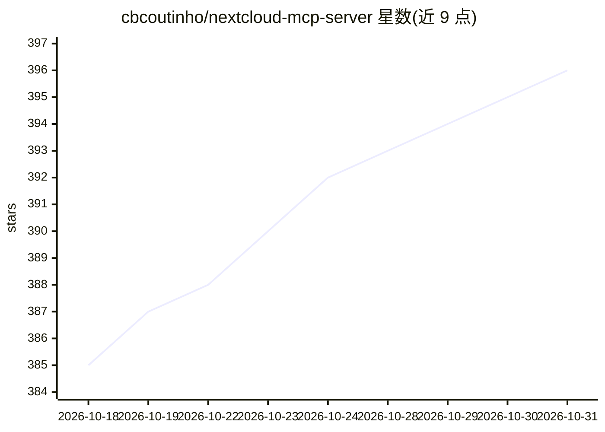

# cbcoutinho/nextcloud-mcp-server

⭐ 396 · Python · AGPL-3.0 · 推送 2026-10-30 · [GitHub](https://github.com/cbcoutinho/nextcloud-mcp-server) · 个人维护

**连接 AI 助手与 Nextcloud 的独立 MCP 服务器**

独立运行的 MCP 服务器，让 Claude、GPT、Gemini 等 LLM 通过自然语言操作 Nextcloud 数据：覆盖 Notes、Calendar、Contacts、Files、Deck、Mail、Talk 等 10 余个应用的 110+ MCP 工具，支持 CRUD、OCR 文档处理、共享管理与标签排除。认证采用应用密码 Basic Auth，多用户可经 Login Flow v2/OAuth。提供可选的实验性语义搜索（需 Qdrant + Ollama 向量与嵌入服务）。部署方式含 uvx、Docker、Kubernetes（Helm）与本地安装；另有托管服务 Astrolabe Cloud 在开发中。

## 筛选速览

| 维度 | 判定 | 备注 |
|---|---|---|
| AI 角色 | `ai-ecosystem` | LLM/agent 周边工具 |
| 许可风险 | `viral` | AGPL-3.0 |
| 部署形态 | `self-host` | docker 或自建部署 |
| 模型依赖 | local-ok | 支持本地模型 |
| 硬件要求 | — | 无带数字的原话,不猜 |
| 安装摩擦 | `low` | 无编译、无系统依赖或容器化 |
| 成熟度 | `idea` | |

## 能力要点

- 110+ MCP 工具覆盖 10 余个 Nextcloud 应用的 CRUD 操作
- 三种认证模式：单用户 Basic Auth、透传与 Login Flow v2（OAuth）
- 实验性 RAG 语义搜索（Notes/Files/News/Deck/Mail，需 Qdrant + Ollama）
- PDF/DOCX/图像的 OCR 与文本提取

## 适用场景

- 在 Claude Code 或 IDE 中用对话管理我的 Nextcloud 笔记、日历与文件
- 让 AI 客户端对 Nextcloud 内容做语义检索而不仅靠关键词
- 多用户部署下让每人以自己的身份访问 Nextcloud 数据

## 场景标签

`语义搜索` `OCR` · 领域:知识与检索

## 证据(README 行号)

> L7: **A production-ready MCP server that connects AI assistants to your Nextcloud instance.**
> L11: This is a **dedicated standalone MCP server** designed for external MCP clients like Claude Code and IDEs. It runs 
> L60: - **110+ MCP Tools** - Comprehensive API coverage across 10 Nextcloud apps

## 星数曲线

2026-10-18 385 → 2026-10-31 396（+11）

---
*卡片 v1 · prompt 1.4 · 生成 2026-10-21 · 置信度 high · 依据 README sha `33ad95feb91e` · [字段定义](../../DATASET.md)*
