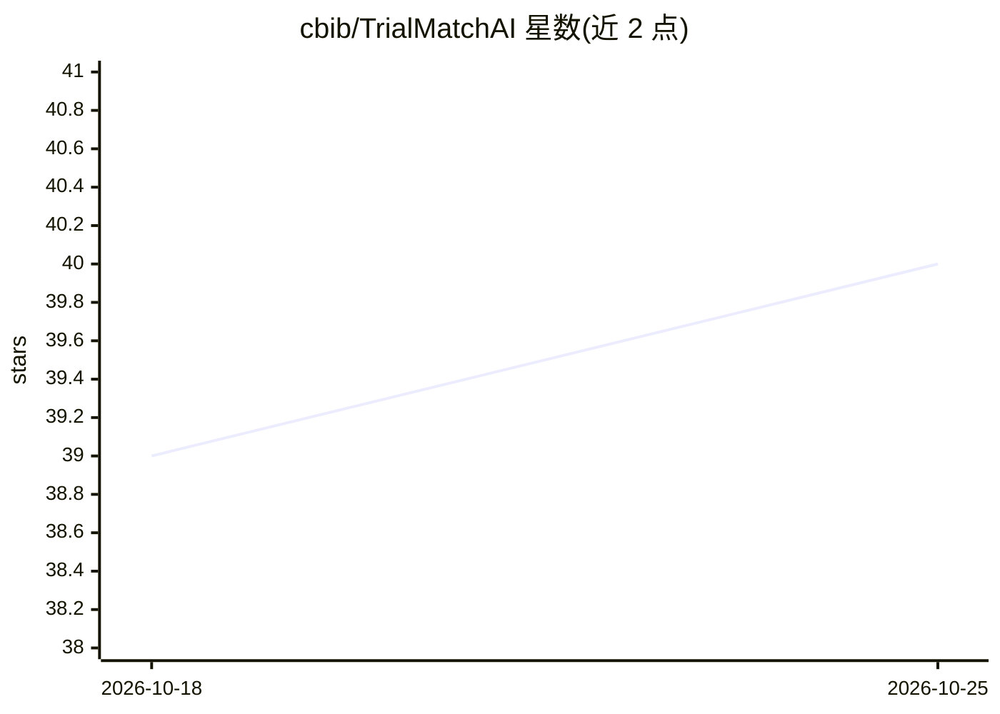

# cbib/TrialMatchAI

⭐ 40 · Python · NOASSERTION · 推送 2026-10-23 · [GitHub](https://github.com/cbib/TrialMatchAI) · [官网](https://cbib.github.io/TrialMatchAI/) · 组织维护

**患者与临床试验匹配的 CLI：检索、入组资格评估与报告生成**

可配置的命令行工具：导入文本、FHIR、Phenopacket、OMOP 格式的患者信息，在本地 LanceDB 试验索引上做 BM25/向量/混合检索与多通道融合，再由本地模型完成生物医学实体抽取、重排与逐条标准的入组资格评估，输出排名结果与 HTML 报告。默认配置使用 BGE-M3、GLiNER2、Gemma-2-2b-it、Phi-4 等模型。面向需要自行搭建试验匹配流程的临床研究人员与开发者；声明为 beta 版，GPU 推理与临床准确性未经认证，结果需人工复核。

## 筛选速览

| 维度 | 判定 | 备注 |
|---|---|---|
| AI 角色 | `ai-native` | 本体是模型或模型工具 |
| 许可风险 | `permissive` | NOASSERTION |
| 部署形态 | `library` | 以包/库形式分发 |
| 模型依赖 | — | README 未给出锁定关系 |
| 硬件要求 | — | 无带数字的原话,不猜 |
| 安装摩擦 | `medium` | 含编译或系统依赖之一 |
| 成熟度 | `idea` | |

## 能力要点

- 多格式患者数据导入（Text/FHIR/Phenopacket/OMOP）与本地 LanceDB 检索（BM25/向量/混合）
- 模型阶段：实体抽取、默认开启的重排与逐条标准的资格评估，可选查询扩展
- CoT 与 direct JSON 两种资格评估 prompt 模式可独立开关，支持仅检索旁路
- 在 TREC 2021-2023 试验匹配数据上报告 nDCG、P@10 与召回率等评测结果

## 适用场景

- 我想为患者档案自动检索并排序可能合适的临床试验
- 我需要对每条入组标准生成资格判定与证据说明供人工复核
- 我想在自己的试验语料上复现论文实验或评测不同嵌入/资格评估模型

## 场景标签

`推荐系统` `模型评测` · 领域:评测与运维

## 证据(README 行号)

> L13: TrialMatchAI imports patient information, searches a local clinical-trial index,
> L14: and produces ranked results and portable HTML reports. Configured local models perform biomedical entity extraction
> L97: The default configuration selects `BAAI/bge-m3` embeddings,

## 星数曲线

2026-10-18 39 → 2026-10-25 40（+1）

---
*卡片 v1 · prompt 1.4 · 生成 2026-10-25 · 置信度 high · 依据 README sha `3c1eef066a8b` · [字段定义](../../DATASET.md)*
