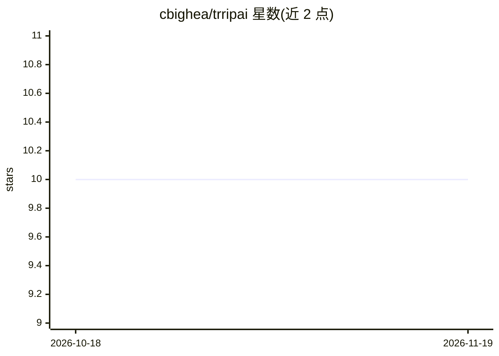

# cbighea/trripai

⭐ 10 · Go · Apache-2.0 · 推送 2026-05-05 · [GitHub](https://github.com/cbighea/trripai) · 个人维护

**AI agent 进程的系统调用级安全监管器**

以受监管子进程方式 fork 用户的 AI agent（如 Claude Code、Codex、aider），实时拦截文件/网络/进程系统调用，经多过滤器打分管线（p99 ≤15ms）判定，在 TUI 中展示排队或拒绝的动作；过滤器全部为确定性规则，不含 LLM 判分。策略为 TOML 文件加可选 CEL 表达式，支持用户白名单、过滤器开关、审计 JSONL+SQLite 与 HMAC 完整性签名。Linux 全量拦截，macOS 仅观察模式。

## 筛选速览

| 维度 | 判定 | 备注 |
|---|---|---|
| AI 角色 | `ai-ecosystem` | LLM/agent 周边工具 |
| 许可风险 | `permissive` | Apache-2.0 |
| 部署形态 | `self-host` | docker 或自建部署 |
| 模型依赖 | — | README 未给出锁定关系 |
| 硬件要求 | — | 无带数字的原话,不猜 |
| 安装摩擦 | `low` | 无编译、无系统依赖或容器化 |
| 成熟度 | `idea` | |

## 能力要点

- seccomp-unotify+pidfd 实时系统调用拦截与 block/allow/redirect
- 17 个确定性过滤器分 3 阶段打分，无 LLM judge
- TOML+CEL 策略、用户白名单与 CI 漂移审计
- 可选 ONNX 意图打分（模型经 SHA-256 校验下载）

## 适用场景

- 监管本机运行的编码 agent 的文件与网络行为
- 企业按 TOML 策略统一管控 agent 高危操作
- CI 中审计策略漂移并校验控制完整性

## 场景标签

`网络安全` · 领域:学习与行业

## 证据(README 行号)

> L5: A syscall-level security supervisor for AI agent processes (Claude Code, Codex, aider, etc.).
> L7: It forks your agent as a supervised child, then intercepts file/network/process syscalls in real time, runs each act
> L19: |Linux (kernel >= 5.9)|seccomp-unotify + pidfd|Full block/allow/redirect|Landlock LSM as enforcement floor|

## 星数曲线

2026-10-18 10 → 2026-11-19 10（+0）

---
*卡片 v1 · prompt 1.4 · 生成 2026-11-19 · 置信度 high · 依据 README sha `716f34433f54` · [字段定义](../../DATASET.md)*
