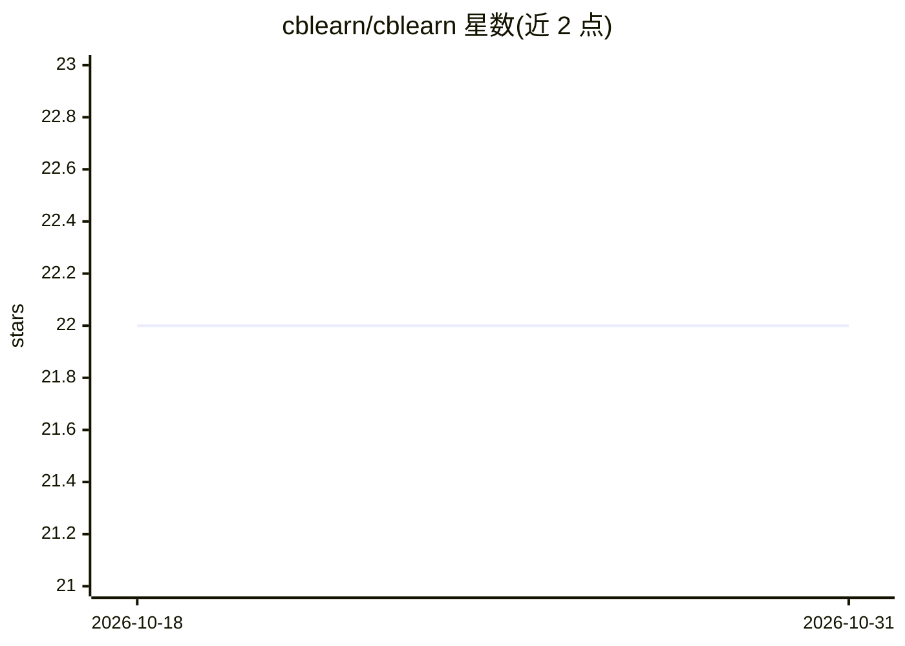

# cblearn/cblearn

⭐ 22 · Python · MIT · 推送 2026-09-10 · [GitHub](https://github.com/cblearn/cblearn) · 组织维护

**基于相似性比较的机器学习 Python 库**

cblearn 提供基于比较的机器学习方法：算法从'A 与 B 比 C 与 D 更相似'的三元组/四元组相似性比较中学习，而非使用特征化数据，涵盖序数嵌入等场景。库兼容 scikit-learn API（示例中使用 cross_val_score 等流程），以 Python 包形式在 PyPI 发布，附有文档、示例与用户指南。由蒂宾根大学 Ulrike von Luxburg 机器学习理论组成员发起，现有维护者团队，发布于 JOSS 期刊，MIT 许可。

## 筛选速览

| 维度 | 判定 | 备注 |
|---|---|---|
| AI 角色 | `ai-native` | 本体是模型或模型工具 |
| 许可风险 | `permissive` | MIT |
| 部署形态 | `library` | 以包/库形式分发 |
| 模型依赖 | — | README 未给出锁定关系 |
| 硬件要求 | — | 无带数字的原话,不猜 |
| 安装摩擦 | `low` | 无编译、无系统依赖或容器化 |
| 成熟度 | — | 结构信号不足 |

## 能力要点

- 从三元组/四元组相似性比较而非特征数据中学习
- 兼容 scikit-learn API 流程
- 附文档、示例与用户指南

## 适用场景

- 仅有相似性比较标注（无特征）时做嵌入与降维
- 众包偏好/感知比较数据的序数嵌入分析
- 在 scikit-learn 工作流中集成比较式学习算法

## 场景标签

 · 领域:机器学习/数据科学

## 证据(README 行号)

> L8: Comparison-based learning methods are machine learning algorithms using similarity comparisons ("A and B are more si
> L37: *cblearn* was initiated by current and former members of the Theory of Machine Learning group of Prof. Dr. Ulrike v

## 星数曲线

2026-10-18 22 → 2026-10-31 22（+0）

---
*卡片 v1 · prompt 1.4 · 生成 2026-10-27 · 置信度 high · 依据 README sha `1cbf91f6b3b1` · [字段定义](../../DATASET.md)*
