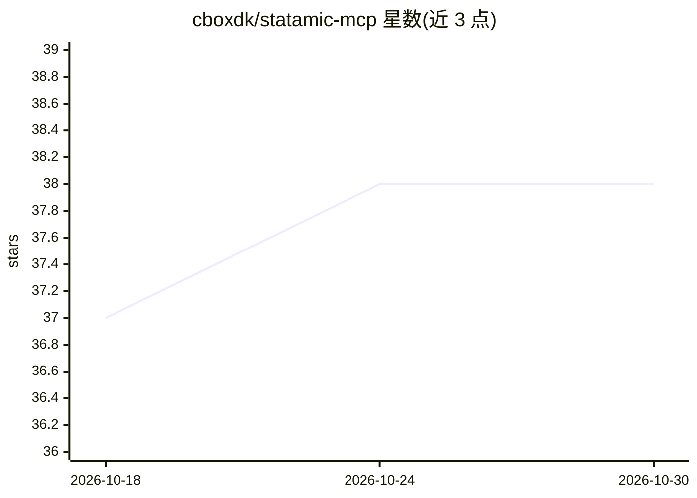

# cboxdk/statamic-mcp

⭐ 38 · PHP · MIT · 推送 2026-10-29 · [GitHub](https://github.com/cboxdk/statamic-mcp) · [官网](https://cbox.dk/packages/statamic-mcp) · 个人维护

**给 AI 助手接入 Statamic CMS 的 MCP 服务器**

面向 Statamic CMS v6 的 Model Context Protocol 服务器，通过 11 个领域路由器（蓝图、条目、术语、全局集、结构、资产、用户、系统等）向 AI 助手暴露结构化的内容管理操作，包括创建/更新/发布条目、生成 TypeScript/PHP 类型、内容审计等。提供 Web MCP 端点、作用域 API 令牌（21 种权限）、OAuth 2.1、审计日志与 CP 控制面板。要求 PHP 8.3+、Laravel 12+、Statamic 6.6+，通过 Composer 安装；支持其他包注册自定义工具路由器。

## 筛选速览

| 维度 | 判定 | 备注 |
|---|---|---|
| AI 角色 | `ai-ecosystem` | LLM/agent 周边工具 |
| 许可风险 | `permissive` | MIT |
| 部署形态 | `None` |  |
| 模型依赖 | — | README 未给出锁定关系 |
| 硬件要求 | — | 无带数字的原话,不猜 |
| 安装摩擦 | `low` | 无编译、无系统依赖或容器化 |
| 成熟度 | — | 结构信号不足 |

## 能力要点

- 11 个领域路由器以 action-based routing 组织 Statamic 能力
- 作用域令牌（21 种权限）+ OAuth 2.1 + 审计日志的安全机制
- 工具目录按需发现（search_tools/execute_tools）以减少上下文占用
- CP 内 Vue 3 仪表盘管理令牌、审计与设置

## 适用场景

- 让 Claude/Cursor 等 AI 客户端直接读写 Statamic 站点内容
- 通过对话创建条目、管理蓝图与资产
- 为 Statamic 站点做内容审计与类型生成

## 场景标签

 · 领域:CMS/开发工具

## 证据(README 行号)

> L3: A comprehensive MCP (Model Context Protocol) server for Statamic CMS v6 that provides AI assistants with structured 
> L49: See Getting Started for detailed setup or AI Client Setup for client-specific instructions (Claude, Cursor, ChatGPT

## 星数曲线

2026-10-18 37 → 2026-10-30 38（+1）

---
*卡片 v1 · prompt 1.4 · 生成 2026-10-25 · 置信度 high · 依据 README sha `e44fb7d4ca93` · [字段定义](../../DATASET.md)*
