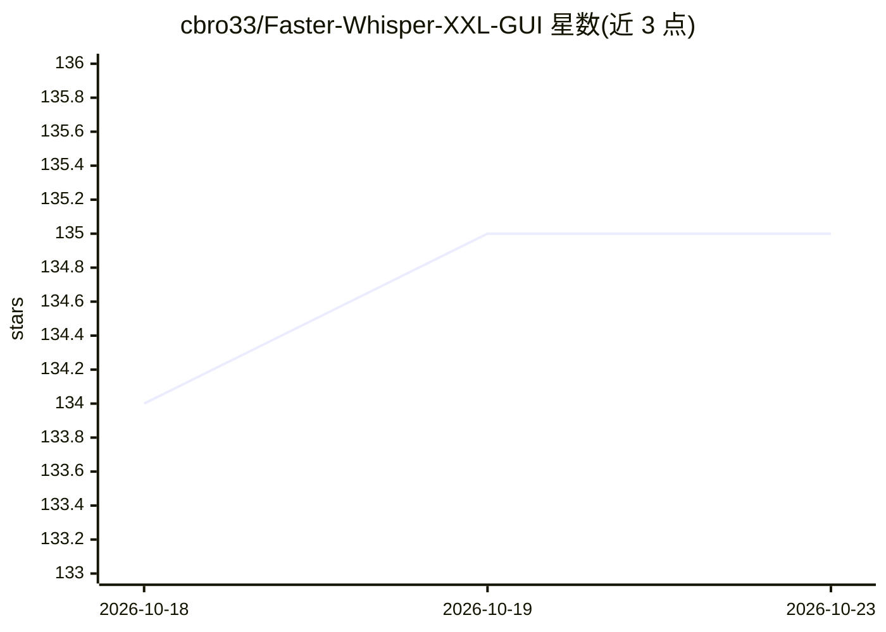

# cbro33/Faster-Whisper-XXL-GUI

⭐ 135 · Python · GPL-3.0 · 推送 2026-08-11 · [GitHub](https://github.com/cbro33/Faster-Whisper-XXL-GUI) · [官网](https://cbro33.github.io/faster-whisper-xxl-gui-site) · 个人维护

**Faster-Whisper-XXL 转录引擎的桌面 GUI：本地文件与 YouTube 语音转文字**

为 Faster-Whisper-XXL 转录引擎提供的桌面界面（Python/PyInstaller 构建）：支持本地文件与经 yt-dlp 下载的 YouTube 音视频转录，提供模型/任务/语言控制、VAD 与音频选项，Model Manager 可从 Hugging Face 或本地导入模型并支持 Transformers 转 CT2 转换。输出 SRT/VTT/JSON/TXT 等多种格式，支持跳过或覆盖已有输出以续跑批量任务。Windows 提供 .exe 免安装运行，首次启动自动下载引擎与 FFmpeg；也可从 Python 源码运行。

## 筛选速览

| 维度 | 判定 | 备注 |
|---|---|---|
| AI 角色 | `ai-native` | 本体是模型或模型工具 |
| 许可风险 | `viral` | GPL-3.0 |
| 部署形态 | `desktop` | 安装包/桌面程序 |
| 模型依赖 | — | README 未给出锁定关系 |
| 硬件要求 | — | 无带数字的原话,不猜 |
| 安装摩擦 | `medium` | 含编译或系统依赖之一 |
| 成熟度 | `idea` | |

## 能力要点

- 本地文件与 YouTube 音视频转录，输出 SRT/VTT/JSON/TXT 等多格式
- 模型管理器支持 HF/本地 CT2 模型与 Transformers→CT2 转换
- 自动依赖安装（Faster-Whisper-XXL + FFmpeg）
- 支持跳过/覆盖已有输出，可续跑中断的批量任务

## 适用场景

- 把本地音频视频转成字幕文件
- 下载并转录 YouTube 视频内容
- 管理多个 Whisper 转录模型并按需切换

## 场景标签

`语音识别` · 领域:感知与多模态

## 证据(README 行号)

> L5: Faster Whisper XXL GUI is a desktop interface for the Faster Whisper XXL transcription engine. It supports local fil
> L9: - File and YouTube transcription (audio-only or full video).

## 星数曲线

2026-10-18 134 → 2026-10-23 135（+1）

---
*卡片 v1 · prompt 1.4 · 生成 2026-10-22 · 置信度 mid · 依据 README sha `fbc20a578c75` · [字段定义](../../DATASET.md)*
