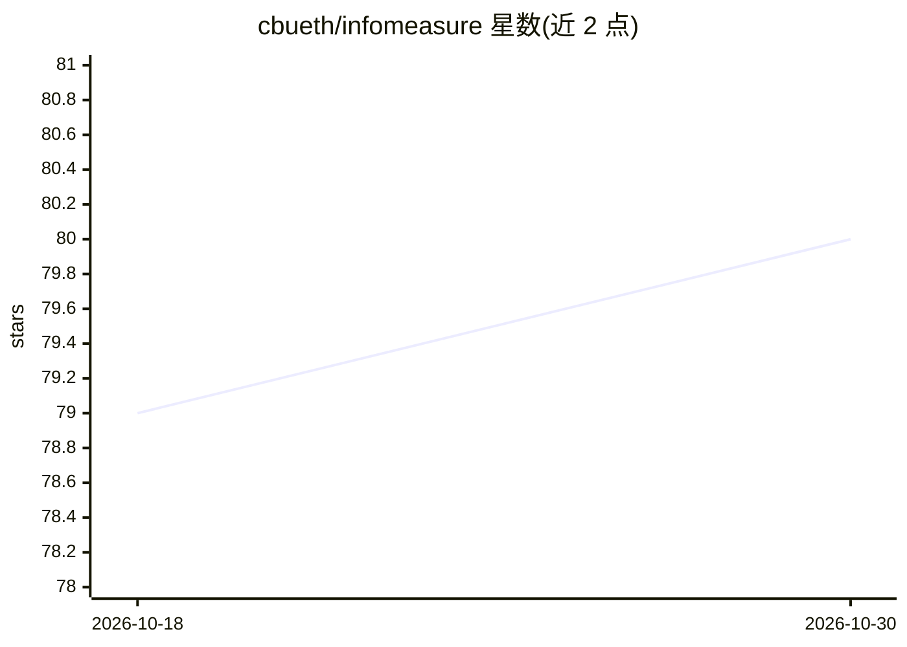

# cbueth/infomeasure

⭐ 80 · Python · AGPL-3.0 · 推送 2026-10-01 · [GitHub](https://github.com/cbueth/infomeasure) · [官网](https://infomeasure.org/) · 个人维护

**计算熵、互信息、传递熵等信息度量的 Python 库**

面向科研与数据科学的 Python 包，提供连续与离散变量的熵、互信息、传递熵等信息度量计算，支持多种估计技术。通过 pip/conda 安装，依赖由 pyproject.toml 自动管理，提供 Jupyter 内核配置说明与开发环境搭建流程。另有关联的 Rust 实现 infomeasure-rs（编译期类型安全、GPU 加速）。README 列出其在浏览器指纹、风电监测、脑网络连接等多领域研究中的引用情况。

## 筛选速览

| 维度 | 判定 | 备注 |
|---|---|---|
| AI 角色 | `ai-enhanced` | 去掉 AI 部分产品仍成立 |
| 许可风险 | `viral` | AGPL-3.0 |
| 部署形态 | `library` | 以包/库形式分发 |
| 模型依赖 | — | README 未给出锁定关系 |
| 硬件要求 | — | 无带数字的原话,不猜 |
| 安装摩擦 | `low` | 无编译、无系统依赖或容器化 |
| 成熟度 | — | 结构信号不足 |

## 能力要点

- 支持连续与离散变量的熵、互信息、传递熵等信息度量
- 多种估计技术可选
- 可从 PyPI 与 conda-forge 安装
- 存在 Rust 实现 infomeasure-rs，含 GPU 加速

## 适用场景

- 研究中计算时间序列的传递熵与互信息
- 分析复杂网络与神经科学数据的依赖关系
- 浏览器指纹等信息论风险度量研究

## 场景标签

`科研工具` · 领域:学习与行业

## 证据(README 行号)

> L31: Continuous and discrete entropy and information measures using different estimation
> L40: `infomeasure` is used across research fields (selection, as of August 2026):

## 星数曲线

2026-10-18 79 → 2026-10-30 80（+1）

---
*卡片 v1 · prompt 1.4 · 生成 2026-10-24 · 置信度 mid · 依据 README sha `10695f68d7b6` · [字段定义](../../DATASET.md)*
