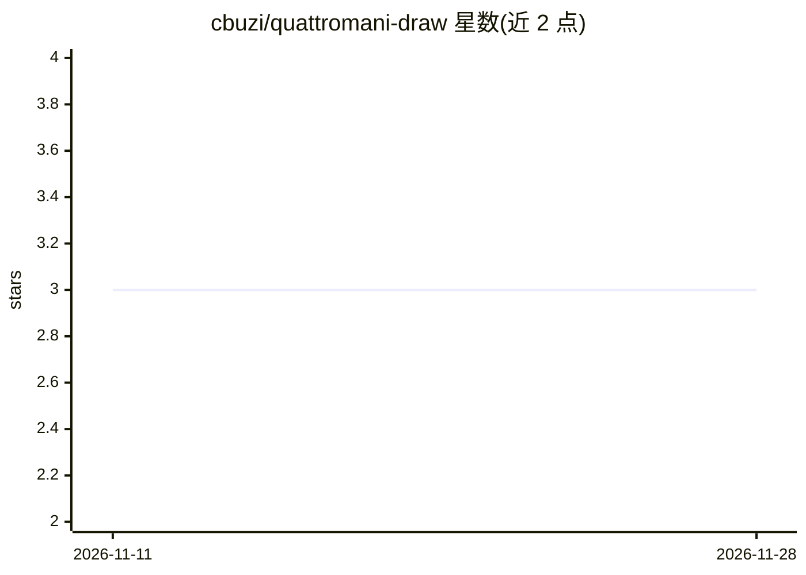

# cbuzi/quattromani-draw

⭐ 3 · C# · Apache-2.0 · 推送 2026-11-12 · [GitHub](https://github.com/cbuzi/quattromani-draw) · 个人维护

**与 AI 代理同画布协作的矢量图形编辑器**

基于 .NET 10 与 Avalonia 的跨平台矢量编辑器，提供钢笔、节点编辑、渐变、布尔运算、路径文字、位图描摹与 SVG/PDF/PNG 导入导出。架构上通过单一命令总线连接人类与 AI 代理：代理经内置 MCP 服务器（localhost:5577）发送 JSON 命令，每批命令为一个可撤销事务，所有对象带稳定 id、语义命名与相对定位，代理可查询版本差异以适应人类的手动修改。三个平台均有免安装 .NET 的自包含发布包，源码构建需 .NET 10 SDK。目前为 beta，macOS 日常使用，Linux 版本未经实际验证。

## 筛选速览

| 维度 | 判定 | 备注 |
|---|---|---|
| AI 角色 | `ai-enhanced` | 去掉 AI 部分产品仍成立 |
| 许可风险 | `permissive` | Apache-2.0 |
| 部署形态 | `None` |  |
| 模型依赖 | — | README 未给出锁定关系 |
| 硬件要求 | — | 无带数字的原话,不猜 |
| 安装摩擦 | `medium` | 含编译或系统依赖之一 |
| 成熟度 | `idea` | |

## 能力要点

- 人类与 AI 代理共享同一文档与命令总线，代理操作一步可撤销
- MCP 服务器暴露 get_document/execute/render 等工具，代理可查看自己绘制结果
- 相对定位与语义命名降低代理调用门槛，错误返回修复示例
- 内置一键启动 Claude Code、Codex 或 OpenCode 并自动连接

## 适用场景

- 与 AI 代理协作绘制矢量插画，人工随时接手调整节点
- 让代理基于已有设计继续编辑并保留人的改动
- 将位图描摹为矢量路径后交由代理批量重排或上色

## 场景标签

`图像生成` · 领域:内容生成

## 证据(README 行号)

> L23: Quattromani Draw is different. It is a real vector editor — pen, nodes, gradients, layers, booleans, text on a path
> L92: Quattromani starts an MCP server on `http://localhost:5577/mcp` while it is open (set `QUATTROMANI_PORT` to change 
> L43: There is one document and **one command bus**. The UI never touches the document directly: you and the agent are tw

## 星数曲线

2026-11-11 3 → 2026-11-28 3（+0）

---
*卡片 v1 · prompt 1.4 · 生成 2026-11-22 · 置信度 high · 依据 README sha `19810742ccce` · [字段定义](../../DATASET.md)*
