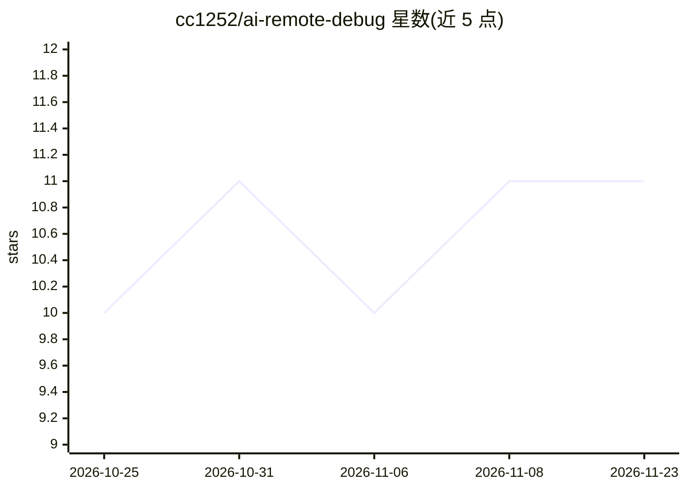

# cc1252/ai-remote-debug

⭐ 11 · Python · MIT · 推送 2026-11-01 · [GitHub](https://github.com/cc1252/ai-remote-debug) · 个人维护 · 中文 README

**自托管远程诊断基础设施：让 AI 诊断客户 PC 与 Android**

ARD 由三部分组成：自托管 Relay（FastAPI 服务，负责设备注册、命令中继、日志流与文件传输）、客户侧 Agent（Windows 单文件 EXE，可检查进程、服务、日志、网络状态并执行授权修复命令）、Android Executor（logcat、shell/root、应用管理、截图与文件操作）。工程师通过 ard CLI 或 MCP Server 让 AI 客户端读取真实系统状态。客户只需双击 EXE；Relay 使用单一共享 token、状态存内存，README 明确其适合个人与小团队而非企业多租户场景。

## 筛选速览

| 维度 | 判定 | 备注 |
|---|---|---|
| AI 角色 | `ai-ecosystem` | LLM/agent 周边工具 |
| 许可风险 | `permissive` | MIT |
| 部署形态 | `desktop` | 安装包/桌面程序 |
| 模型依赖 | — | README 未给出锁定关系 |
| 硬件要求 | — | 无带数字的原话,不猜 |
| 安装摩擦 | `low` | 无编译、无系统依赖或容器化 |
| 成熟度 | `idea` | |

## 能力要点

- MCP Server 与 CLI 双接口，向 AI 客户端暴露可发现的诊断工具
- 客户 PC 与 Android 均为一等诊断目标，黑屏/recovery/fastboot 下可经 PC Agent 的 ADB/fastboot 继续
- 客户侧出站连接，无需固定 IP、不暴露端口
- 附 ai-remote-debug Skill（SKILL.md 诊断流程手册）

## 适用场景

- 客户电脑上软件运行失败，远程收集进程、日志与配置证据
- "我机器上没问题"类环境差异的对比诊断
- 远程管理 Android 测试设备：读日志、装 APK、重启应用
- 为 AI 生成的交付软件提供售后诊断通道

## 场景标签

 · 领域:开发者工具/远程支持

## 证据(README 行号)

> L14: AI Remote Debug (ARD) closes that gap. A lightweight agent on a customer PC or Android device connects outbound to 
> L31: - **AI-native diagnostics**: MCP and CLI expose explicit tools and machine-readable results instead of asking an AI
> L150: MCP is ARD's primary AI interface. Once the device owner has authorized and deployed an executor, an AI client can

## 星数曲线

2026-10-25 10 → 2026-11-23 11（+1）

---
*卡片 v1 · prompt 1.4 · 生成 2026-11-18 · 置信度 high · 依据 README sha `56fa96c9a306` · [字段定义](../../DATASET.md)*
