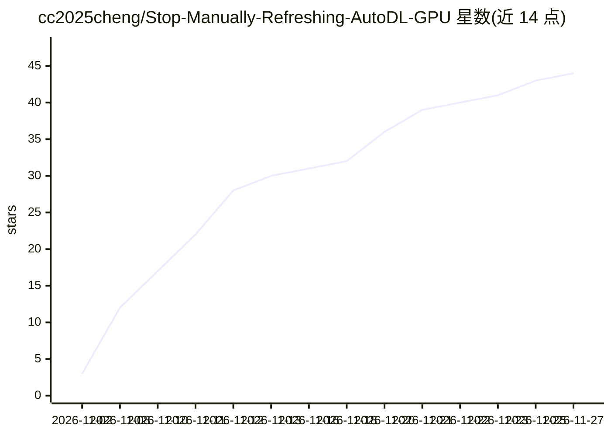

# cc2025cheng/Stop-Manually-Refreshing-AutoDL-GPU

⭐ 44 · JavaScript · MIT · 推送 2026-11-24 · [GitHub](https://github.com/cc2025cheng/Stop-Manually-Refreshing-AutoDL-GPU) · 个人维护 · 中文 README

**AutoDL 租卡用户的空闲 GPU 监控与自动开机工具**

面向 AutoDL 平台租卡用户的本地工具：设定 GPU 型号、卡数、地区并授权后，每秒检查库存，空闲卡出现即自动创建并开机，也支持同地区克隆换卡。本机无需 GPU，Windows 上双击脚本启动，服务只监听 127.0.0.1，通过专用浏览器中用户本人登录的会话操作页面，不调用私有接口。可选 AI 选卡功能：读取项目 README/依赖文件按规则判断哪些 GPU 可跑，规则读不准时用用户自有 Key 的模型（DeepSeek、阿里云百炼等）补充，不填 Key 也可用规则部分；AI 不参与监测与下单。非官方工具，与 AutoDL 无隶属关系。

## 筛选速览

| 维度 | 判定 | 备注 |
|---|---|---|
| AI 角色 | `ai-enhanced` | 去掉 AI 部分产品仍成立 |
| 许可风险 | `permissive` | MIT |
| 部署形态 | `None` |  |
| 模型依赖 | — | README 未给出锁定关系 |
| 硬件要求 | `cpu-ok` | |
| 安装摩擦 | `medium` | 含编译或系统依赖之一 |
| 成熟度 | — | 结构信号不足 |

## 能力要点

- 按型号/卡数/地区监测空闲 GPU，出现即自动创建并开机
- 同地区克隆换卡，源实例只读
- 规则优先的 AI 选卡：解析依赖与显存需求对照真实 GPU 目录，AI 仅做建议且需自带 Key
- 防重复付费：提交意图写盘、点击后对账实例列表，结果不明即停

## 适用场景

- 抢租热门 GPU（如 4090/5090），不再手动刷新页面
- 把已关机实例克隆到同地区其他空闲 GPU 上换卡
- 贴项目 README 让工具算出哪些 GPU 能跑这个项目

## 场景标签

`浏览器自动化` · 领域:效率与自动化

## 证据(README 行号)

> L21: - ⚡ **空闲即开机**：按你设的型号、卡数和地区（可多选），默认每秒检查一次，发现空闲 GPU 立即创建并开机。
> L26: - 💻 **门槛低**：本机不需要 GPU，中文界面，双击启动；不用 AI 也能完整使用。
> L86: - 🤖 **AI 补充（可选）**：规则读不准的地方，例如表格里按模型大小列出的多个显存数字，由你自己 API Key 上的模型（DeepSeek、阿里云百炼等）按需求挑出。每条结论都引用原文，由程序核对。一次约 600～1100

## 星数曲线

2026-11-02 3 → 2026-11-27 44（+41）

---
*卡片 v1 · prompt 1.4 · 生成 2026-11-18 · 置信度 high · 依据 README sha `834e4b8530bb` · [字段定义](../../DATASET.md)*
