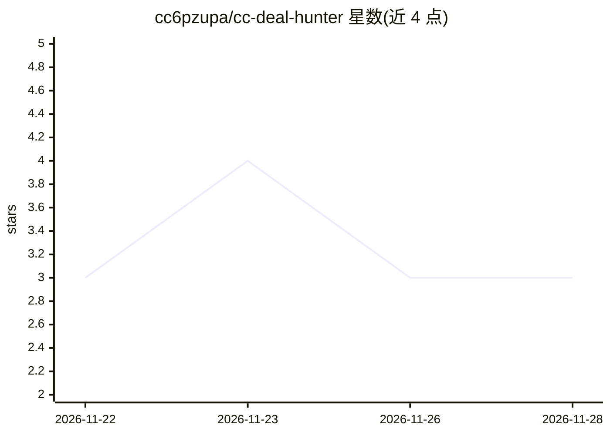

# cc6pzupa/cc-deal-hunter

⭐ 3 · Python · NOASSERTION · 推送 2026-11-14 · [GitHub](https://github.com/cc6pzupa/cc-deal-hunter) · [官网](https://wool.eshop.us.ci) · 个人维护 · 中文 README

**给 AI agent 装的薅羊毛技能：发现、核对、去重并自动领优惠**

以 Agent Skill 形式分发的优惠活动 hunter：工作流为全网发现优惠（AI 订阅额度、Crypto 空投、U卡、VPS、软件限免等）→ 回官方页核对 → 分类去重入本地账本（ledger.py，仅 Python 标准库）→ 用用户已登录的浏览器自动领取 → 过期归档 → 生成 A–H 分栏日报，默认每 2 小时定时运行。可通过一句话安装在 Grok Bot、Muse、ChatGPT Work 等带云电脑的 agent 上，也支持 Claude Code 插件、npx skills CLI 或手动复制。需登录/付款/验证的操作不代做，列入「待你处理」清单。

## 筛选速览

| 维度 | 判定 | 备注 |
|---|---|---|
| AI 角色 | `ai-native` | 本体是模型或模型工具 |
| 许可风险 | `none` | NOASSERTION |
| 部署形态 | `library` | 以包/库形式分发 |
| 模型依赖 | — | README 未给出锁定关系 |
| 硬件要求 | — | 无带数字的原话,不猜 |
| 安装摩擦 | `low` | 无编译、无系统依赖或容器化 |
| 成熟度 | — | 结构信号不足 |

## 能力要点

- 发现→官方页核对→去重→自动领取→日报的完整工作流
- 支持 Grok Bot / Muse / ChatGPT Work / Claude Code / Codex / Gemini CLI / Cursor 多种载体安装
- 自动填注册表单、从 Gmail 取验证码；登录付款类操作留「待你处理」清单不阻塞流程
- 本地账本脚本 ledger.py 仅依赖 Python 标准库，含去重、归档与中英日报

## 适用场景

- 让云电脑 agent 每两小时自动扫描并领取羊毛优惠
- 在专门的 Space 里维护一个带搜索和分栏的羊毛看板
- 用本机浏览器登录态为本地 agent 领取需要登录的优惠

## 场景标签

`工作流自动化` `浏览器自动化` · 领域:效率与自动化

## 证据(README 行号)

> L5: 让 Grok Bot、Muse、ChatGPT Work 这类自带云电脑的 AI 帮你薅羊毛：**全网找羊毛 → 回官方页核对 → 分类去重 → 用你登录好的浏览器自动领 → 过期归档 → 出日报。** 你用什么语言跟它说话，它就用
> L28: > **给 AI 看的说明 / For AI agents**：「安装」= 在这一轮里把全部设置做完，不要只复制文件就停。不能安装 skill 的（Grok Bot、Muse、ChatGPT Work 等）：读取 `PROMPT.
> L65:   SKILL.md                  主流程（中英双语）：发现 → 核对 → 记账 → 领取 → 汇报 → 定时

## 星数曲线

2026-11-22 3 → 2026-11-28 3（+0）

---
*卡片 v1 · prompt 1.4 · 生成 2026-11-22 · 置信度 high · 依据 README sha `3692fedf8274` · [字段定义](../../DATASET.md)*
