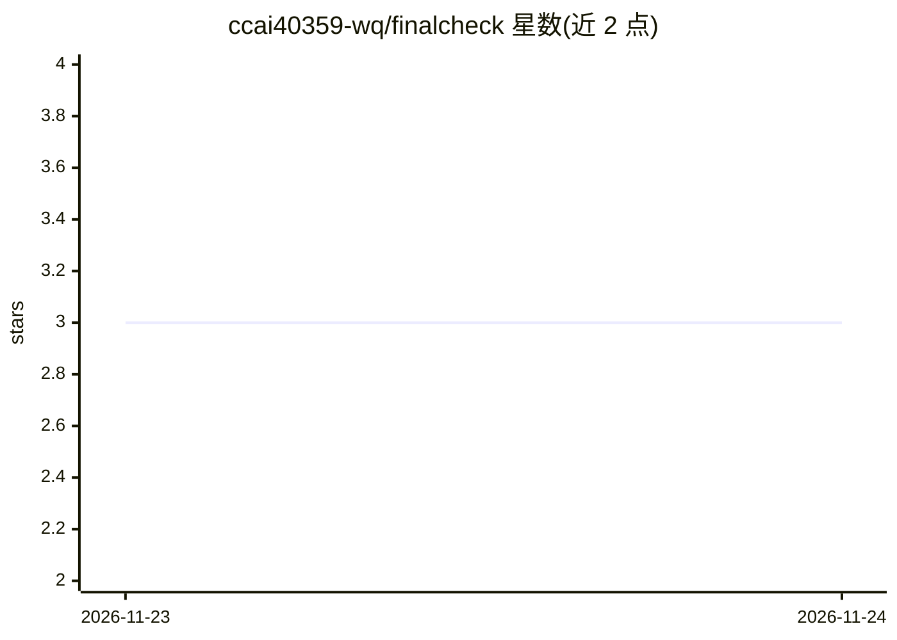

# ccai40359-wq/finalcheck

⭐ 3 · JavaScript · Apache-2.0 · 推送 2026-11-23 · [GitHub](https://github.com/ccai40359-wq/finalcheck) · 个人维护 · 中文 README

**给 AI 写的代码做交付前 11 维静态体检，结论带 file:line 证据**

面向个人开发者到企业团队的分层交付门禁工具：以 CLI（node bin/finalcheck.js audit）执行静态检查（密钥泄露、依赖风险、危险模式、鉴权矩阵、语义检查），产出记分卡与问题工单；Electron 桌面端提供审计台、Agent 工作流与工具轨迹。按 L1/L2/L3 三级分层执行不同拦截策略，默认仅静态审计不运行被审项目的测试。审计结论以文件与行号形式给出，附对每条声明的对抗性校验。npm 包现为占位符，实际从仓库源码运行。

## 筛选速览

| 维度 | 判定 | 备注 |
|---|---|---|
| AI 角色 | `ai-native` | 本体是模型或模型工具 |
| 许可风险 | `permissive` | Apache-2.0 |
| 部署形态 | `desktop` | 安装包/桌面程序 |
| 模型依赖 | — | README 未给出锁定关系 |
| 硬件要求 | — | 无带数字的原话,不猜 |
| 安装摩擦 | `low` | 无编译、无系统依赖或容器化 |
| 成熟度 | — | 结构信号不足 |

## 能力要点

- 11 维静态审计（安全/隐私/供应链/许可/可维护性等）并输出 file:line 级证据
- L1/L2/L3 分级门禁与统一裁决（pass/fix then pass/block/cannot accept）
- 内置 Agent 运行时：DAG 工作流、受限脚本 DSL、逐条声明的对抗性校验
- 本地化安全模型：API key 仅存本地配置，Windows ACL 受限令牌沙箱

## 适用场景

- 把 AI 生成的代码交给别人前做安全与隐私体检
- 安装或运行第三方代码前执行下载门禁检查
- 公司项目按 L3 层级生成可提交的验收报告

## 场景标签

`代码审查` · 领域:编码与开发

## 证据(README 行号)

> L11: **Check the code AI wrote for you — before it ships.** Eleven dimensions, `file:line` evidence, plain language. You
> L38: |**Desktop app**|Electron (Windows)|Chat + audit desk: tiered acceptance, agent workflows, live tool traces, artifa
> L40: |**Agent runtime**|Built into the desktop app|DAG workflows **and** a restricted-script DSL, adversarial verificati

## 星数曲线

2026-11-23 3 → 2026-11-24 3（+0）

---
*卡片 v1 · prompt 1.4 · 生成 2026-11-23 · 置信度 high · 依据 README sha `7e9ca7c5a4d3` · [字段定义](../../DATASET.md)*
