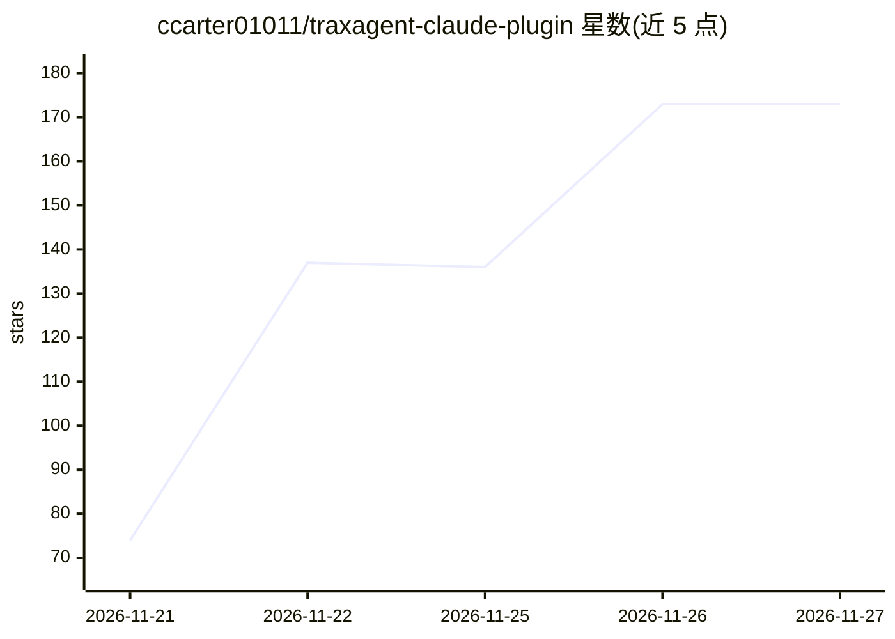

# ccarter01011/traxagent-claude-plugin

⭐ 173 · Python · MIT · 推送 2026-11-24 · [GitHub](https://github.com/ccarter01011/traxagent-claude-plugin) · [官网](https://www.traxagent.io) · 个人维护

**给团队用 AI 助手查询与治理 AI 支出的 MCP 插件**

TraxAgent 提供一个只读 MCP 服务器（https://www.traxagent.io/mcp）和 Claude Code 插件，将 Anthropic、OpenAI、Gemini API 及 Claude Code、Codex、Cursor 等渠道的使用与成本数据按团队和个人汇总，供用户在 Claude、ChatGPT、Cursor、VS Code 等客户端用自然语言提问，获得支出明细、按工作量排序的省钱建议，并可将修复步骤生成为拉取请求。插件本地命令 /spend-audit 直接读取 Claude Code 会话日志，无需账号。MCP 服务器依赖 TraxAgent 账号，采用 OAuth 只读接入，服务有付费方案。

## 筛选速览

| 维度 | 判定 | 备注 |
|---|---|---|
| AI 角色 | `ai-ecosystem` | LLM/agent 周边工具 |
| 许可风险 | `permissive` | MIT |
| 部署形态 | `None` |  |
| 模型依赖 | — | README 未给出锁定关系 |
| 硬件要求 | — | 无带数字的原话,不猜 |
| 安装摩擦 | `low` | 无编译、无系统依赖或容器化 |
| 成熟度 | — | 结构信号不足 |

## 能力要点

- 只读 MCP 服务器 + Claude Code 插件，OAuth 2.1 (PKCE) 接入
- 支持按团队/个人汇总多厂商 AI 支出并输出排序的省钱建议
- /spend-audit 本地读取 Claude Code 日志，按模型/项目/会话出报告，不上传数据
- 附任务成功率与单位成本对比、支出上限预警、AI 资产登记表

## 适用场景

- 月末预算会前用一句话问清各团队 AI 花费与可削减项
- 审计长期未用或无归属的 API key 并建议吊销
- 对比贵价模型与低价模型在自家任务上的效果与单位成本
- 为工程师设置日/周/月 AI 支出上限并提前预警

## 场景标签

`数据分析` `LLM 可观测性` · 领域:效率与自动化

## 证据(README 行号)

> L15: This repo is the Claude Code plugin. The same read-only server, `https://www.traxagent.io/mcp`, also works in Claud
> L153: |`ai-spend` MCP server|Read-only tools: `get_spend_summary`, `get_spend`, `get_people_spend`, `list_fixes`, `get_f

## 星数曲线

2026-11-21 74 → 2026-11-27 173（+99）

---
*卡片 v1 · prompt 1.4 · 生成 2026-11-27 · 置信度 mid · 依据 README sha `c81a59384295` · [字段定义](../../DATASET.md)*
