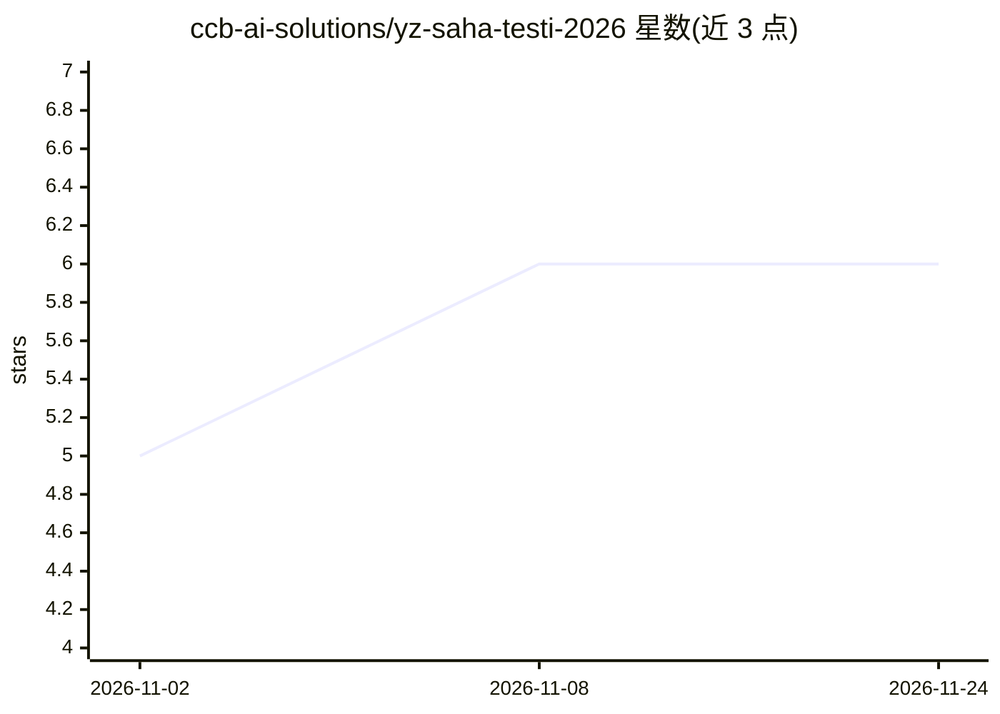

# ccb-ai-solutions/yz-saha-testi-2026

⭐ 6 · HTML · Apache-2.0 · 推送 2026-11-04 · [GitHub](https://github.com/ccb-ai-solutions/yz-saha-testi-2026) · [官网](https://ccb-ai.com) · 组织维护

**14个开源语言模型在土耳其语企业任务上的基准测试报告**

由 CCB AI Solutions 发布的一次性基准测量（2026年10月），对 14 个可自托管的开源权重语言模型与 36 个 pipeline 组件（embedding、reranker、guardrail、OCR、ASR）在土耳其语企业场景下按统一测试计划评测，任务覆盖 RAG、tool calling、工单路由、发票抽取、指令遵循、OCR 与延迟；代码以 Apache-2.0 发布，自建测试数据以 CC BY 4.0 发布，含全部回答与评审记录。作者声明这是单时点快照，不计划持续更新。

## 筛选速览

| 维度 | 判定 | 备注 |
|---|---|---|
| AI 角色 | `ai-knowledge` | 知识聚合/清单类 |
| 许可风险 | `permissive` | Apache-2.0 |
| 部署形态 | `library` | 以包/库形式分发 |
| 模型依赖 | local-ok | 支持本地模型 |
| 硬件要求 | — | 无带数字的原话,不猜 |
| 安装摩擦 | `medium` | 含编译或系统依赖之一 |
| 成熟度 | — | 结构信号不足 |

## 能力要点

- 14 个开源语言模型与 36 个 pipeline 组件在同规则下评测
- 任务覆盖 RAG、tool calling、OCR、guardrail、ASR 与 latency
- 发布代码、测试数据、全部模型回答与评审决策
- RAG 回答由 Claude 经 Anthropic Message Batches API 评分，并做人工抽检校验

## 适用场景

- 为本地化部署选型土耳其语开源模型时复现该测量
- 了解 guardrail/OCR/ASR 等组件在土耳其语场景的测试方法
- 使用其发布的测试数据构造自有评测流程

## 场景标签

`模型评测` · 领域:评测与运维

## 证据(README 行号)

> L3: Açık dil modellerini ve RAG pipeline bileşenlerini, Türkçe kurum işlerinde, aynı testler ve aynı kurallarla ölçtük.
> L4: Kod, test verisi, modellerin verdiği bütün cevaplar, hakem kararları ve sonuç raporu bu repoda.
> L9: > Bu çalışma Ekim 2026'da çekilmiş tek bir fotoğraf. Sürekli güncellenen bir leaderboard değil ve yeni bir tur

## 星数曲线

2026-11-02 5 → 2026-11-24 6（+1）

---
*卡片 v1 · prompt 1.4 · 生成 2026-11-20 · 置信度 mid · 依据 README sha `0540784801a0` · [字段定义](../../DATASET.md)*
