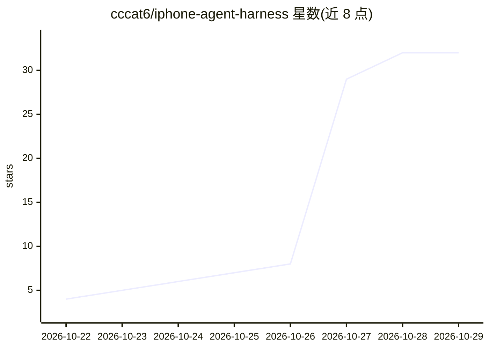

# cccat6/iphone-agent-harness

⭐ 32 · C · MIT · 推送 2026-10-26 · [GitHub](https://github.com/cccat6/iphone-agent-harness) · [官网](https://igent.cc) · 个人维护 · 中文 README

**用 AI 通过 Safari 与 ESP32 蓝牙桥自动化操作 iPhone 的工具**

面向 iPhone 用户（iOS/iPadOS 27+）的浏览器端 Agent 运行环境：Safari 截取屏幕并选取上下文发给用户自选的 AI，校验动作计划后经本地 WebRTC 发给 ESP32 桥，由桥以蓝牙鼠标/键盘方式对手机执行输入，形成观察-动作闭环。无需 Mac、App 或越狱。支持对话管理、社区技能、MCP 工具接入与经 Apple 快捷指令的多语言长文本粘贴；会话与凭据保存在浏览器本地，ChatGPT 订阅需经项目 Cloudflare 中继。

## 筛选速览

| 维度 | 判定 | 备注 |
|---|---|---|
| AI 角色 | `ai-native` | 本体是模型或模型工具 |
| 许可风险 | `permissive` | MIT |
| 部署形态 | `None` |  |
| 模型依赖 | — | README 未给出锁定关系 |
| 硬件要求 | — | 无带数字的原话,不猜 |
| 安装摩擦 | `low` | 无编译、无系统依赖或容器化 |
| 成熟度 | — | 结构信号不足 |

## 能力要点

- Safari 屏幕捕获 + ESP32 蓝牙 HID 输入的操作闭环
- 支持 C2/C3/C5/C6/S3/Classic 六种 ESP32 芯片，浏览器内刷固件
- 社区技能系统与 MCP 工具接入
- 长文本经 Apple 快捷指令粘贴，支持多语言

## 适用场景

- 用自然语言让 AI 在自己 iPhone 上点外卖、设闹钟、跨 App 操作
- 复用社区技能让 agent 更熟练地完成常见手机任务
- 不越狱、不装 App 的前提下给 iPhone 加 AI 自动化能力

## 场景标签

`GUI 自动化` `Agent 框架` · 领域:Agent 开发

## 证据(README 行号)

> L20: Give your iPhone a task in plain language: inspect a screen, enter text, adjust a control or follow a short workflo
> L36: Safari captures the phone screen and sends selected context to your chosen AI. The Harness validates an action plan

## 星数曲线

2026-10-22 4 → 2026-10-29 32（+28）

---
*卡片 v1 · prompt 1.4 · 生成 2026-10-27 · 置信度 high · 依据 README sha `52fc6869c264` · [字段定义](../../DATASET.md)*
